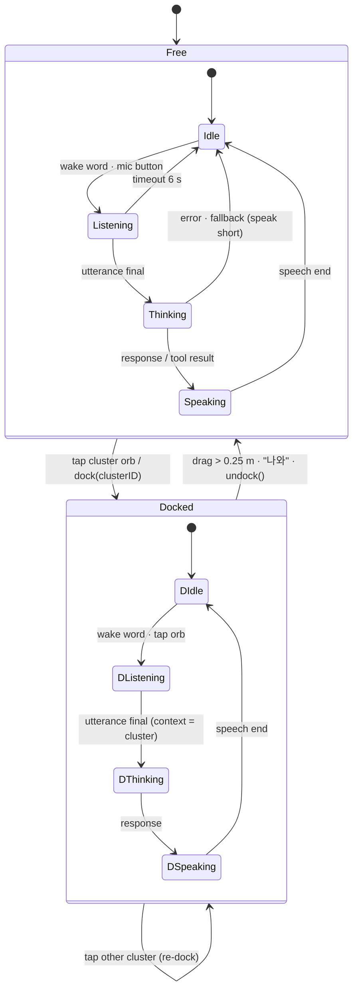
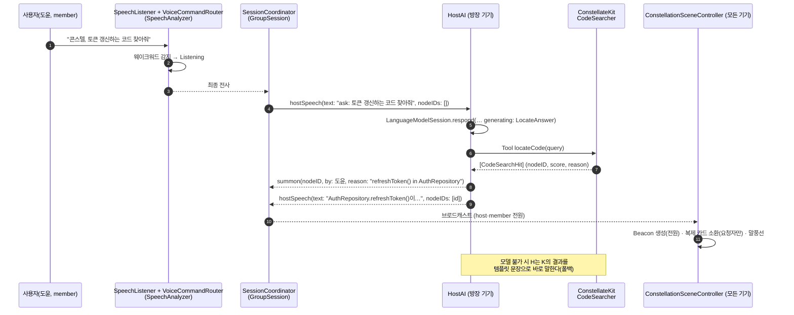

# Tech PRD — Constellate v1.0
**팀이 이머시브 공간에서 코드 별자리를 함께 걸으며 분석·리뷰·교육 회의를 하는 앱**

- 작성일: 2026-10-18
- 작성자: 김민웅(콜슨) · GitHub `kimminung`
- 기준 환경: **Xcode 27 · visionOS 27 / iPadOS 27 / macOS 27** · Swift 5 언어 모드 + 기본 MainActor 격리 + Approachable Concurrency · Combine 금지(async/await)
- 공유 스펙: `Docs/VISION.md` (v0.1) · 디자인: `Docs/PRD-Design-Constellate.md` · 태스크: `Docs/TASKS-Constellate.md`
- 상태: **v1.0 — Kit 구현·테스트 완료(54 테스트 / 9 스위트), 앱 3 플랫폼 빌드 통과(`Scripts/build.sh all` exit 0 ×3), 에셋 7종·텍스처 3종 생성. PR #1 머지 후 2차 라운드(채팅 스트리밍·TTS·포인터 제스처·Accent 재틴트·핀 Markdown 내보내기·follow-host 카메라) 반영. 실기기(Vision Pro·SharePlay 2기기·Apple Intelligence) 검증 미완** — 2026-10-19 갱신
- 저장소: `github.com/kimminung/Constellate` · Bundle ID `com.coulson.Constellate`

---

## 1. 개요와 배경

### 1.1 한 줄 정의

> 프로젝트 폴더 하나를 열면 모든 코드가 **4차원 규칙**(계층 방사형 셸 × 아키텍처 레이어 밴드 × 시간)으로 공간에 뿌려진 "코드 별자리"가 된다. 방장(host)의 **온디바이스 AI**가 Siri형 오브로 떠서 코드 뭉치(cluster)에 들어가 답하거나 떼어져 나와 따라다니고, 팀원은 **SharePlay**로 같은 별자리를 함께 걷는다.

### 1.2 왜 만드는가

2D IDE의 파일 트리와 검색은 "지금 보고 있는 파일" 밖의 구조를 보여주지 못한다. 팀이 코드 전체를 함께 이해해야 하는 순간(온보딩, 아키텍처 리뷰, 리팩터링 전 분석)에는 화이트보드에 상자를 그리게 되는데, 그 상자는 코드와 연결되어 있지 않다. Constellate는 **코드 그 자체**를 규칙 기반으로 공간에 배치해 "구조를 걷는" 경험을 만들고, 방장의 온디바이스 AI가 그 공간 안에서 길잡이가 되게 한다. 코드는 기기를 떠나지 않는다.

### 1.3 출처 프로젝트 통합

세 개의 선행 프로젝트에서 검증된 요소를 가져와 하나의 제품으로 묶는다.

| 출처 | 가져오는 것 | 버리는 것 | 본 문서 반영 위치 |
|---|---|---|---|
| **Immersive Code Calligram IDE** (`PRD-CodeCalligram.md`) | 글리프 아틀라스 + 수천 쿼드 단일 `MeshResource`(알파 마스크), 이리데슨트 ShaderGraph(USDA inline), 프로시저럴 스카이돔/바닥 그리드, 디바운스 비동기 실행, 카드 텍스트를 "글자 흐름"으로 보여주는 캘리그램 연출 | CalligramScript DSL/인터프리터 (쓰는 앱이 아니라 읽는 앱) | FR-3(카드 렌더), FR-8(환경), §7 NFR 성능 |
| **CoulsonAndJarvis** (`README.md`) | Siri형 오브 엔티티(코어·헤일로·밴드 4·파티클 오라·글래스 셸·포인트라이트, Presence 에너지 상태기계), FoundationModels 세션 래퍼(가용성·prewarm·컨텍스트 초과 복구·휴리스틱 폴백), SpeechAnalyzer 파이프라인 + 웨이크워드, 머리 앞 소환(summon), progressive 몰입 전환 | 날씨/무드 생성 | FR-3(오브), FR-4(호스트 AI), FR-5(음성) |
| **CodeFlow3D** (`PRD-CodeFlow3D.md`, `TASKS-CodeFlow3D.md`) | FlowGraph/AnchorPoint/Edge 모델 발상, 틸트 게이트 투영(Z를 연속 함수로 → 타임 다이얼), 단일 Canvas 엣지 렌더(파티클·글로우), 라인 정확 앵커, 레이어 밴드 색, 리뷰 핀 | 손으로 박은 좌표, v1 "Primitive" 3평면 | FR-2(레이아웃·투영), FR-6(리뷰 핀), §6 데이터 모델 |

### 1.4 용어

| 용어 | 뜻 |
|---|---|
| Constellation(별자리) | `CodeGraph`를 `ConstellationLayoutEngine`이 4D로 배치한 결과(`ConstellationLayout`)와 그 씬 |
| Shell(셸) | 트리 깊이별 동심 원환. 깊이 d ≥ 1 → 반지름 `baseRadius + (d−1)·shellSpacing` |
| Sector(섹터) | 한 노드의 서브트리가 소유한 각도 구간 `[sectorStart, sectorEnd]` |
| Layer band(레이어 밴드) | `ArchitectureLayer`별 y 높이 대역 + 색 |
| w / Time dial(타임 다이얼) | 4번째 축(최근 수정도 0…1)과 그것을 3D로 투영하는 사용자 다이얼(−1…1) |
| Cluster / Orb | `ClusterGranularity`로 뭉친 `CodeCluster` 하나 = 오브 하나 |
| Host orb | 방장 기기의 FoundationModels AI를 체현한 Siri형 오브 |
| Dock / Undock | 호스트 오브가 클러스터 오브 안으로 들어감 / 분리됨 |
| Summon(출두) | 찾은 코드 카드의 복제본이 사용자 앞으로 날아오고 원본 자리에 비콘이 서는 것 |
| Beacon(비콘) | 바닥에서 솟는 빛기둥 + 2중 링 (높이 3 m) |

---

## 2. 목표 · 비목표

### 2.1 목표 (v1.0)

| ID | 목표 | 측정 |
|---|---|---|
| G1 | 폴더 하나(≤ 4000 파일)를 열면 10초 안에 별자리가 뜬다 | 인제스트+레이아웃 벽시계 시간, M1 Mac / Vision Pro 실기 |
| G2 | 트리 구조와 그래프 구조가 **공간에서 보존**된다 (형제는 같은 셸의 인접 섹터, 자식은 부모 섹터 안쪽) | 레이아웃 테스트(`LayoutTests`)로 섹터 포함 관계 검증 |
| G3 | 타임 다이얼이 −1…1 어디서든 끊김 없이 연속 투영된다 | `position3(for:timeDial:)` 연속성 테스트 |
| G4 | 방장 AI가 **온디바이스**로 `locateCode`·`explainNode`·`summarizeCluster`·`reviewNode`·`planTour` 5개 도구를 호출하고, 모델 불가 시에도 기능이 유지된다(문장만 단순) | 가용/불가 두 경로 UI 테스트 |
| G5 | "콘스텔, …" 음성 한 마디로 코드가 출두하고 모든 참가자에게 비콘이 동기화된다 | 2기기 SharePlay 실기 |
| G6 | 1 host + n member가 SharePlay로 같은 별자리를 보며 analysis / review / lecture 3 모드를 수행한다 | 2기기 실기 + 메시지 라운드트립 ≤ 300 ms |
| G7 | 테마 규칙(§4.7)이 `validate()`로 검증되고 테스트로 강제된다 | `ThemeTests` 25 케이스 통과 |
| G8 | 하나의 멀티플랫폼 타깃이 visionOS / iPadOS / macOS 3곳에서 빌드·실행된다 | `Scripts/build.sh all` exit 0 |

### 2.2 비목표 (v1.0 제외)

- 코드 **편집**·빌드·실행 (읽기 전용 뷰어다)
- SwiftSyntax 기반 정밀 파싱 (경량 라인/브레이스 스캐너로 충분, §4.1)
- Swift 외 언어의 심볼 추출 (파일 노드까지만; 확장점은 둔다)
- 클라우드 AI, 서버, 계정, 분석(analytics) 전송
- 리뷰 핀의 Git/PR 연동 (내보내기는 JSON까지)
- Multipeer 전송 구현 (메시지 enum은 전송 중립이지만 v1.0은 GroupActivities만)

---

## 3. 페르소나 · 시나리오

### 3.1 페르소나

| 페르소나 | 기기 | 역할 | 원하는 것 |
|---|---|---|---|
| **지연(방장, 테크리드)** | Vision Pro | host | 팀 미팅을 열고, 자기 기기의 AI가 코드에 대해 답하게 하고, 리뷰 결론을 핀으로 남기기 |
| **도윤(팀원, 백엔드 개발자)** | iPad Pro | member | SwiftUI 쪽 구조를 잘 모른다. 방장에게 질문하고 레이저 포인터로 가리키며 토론하기 |
| **하린(학습자, 신입)** | MacBook Pro | member | 가이드 투어를 따라가며(follow-host) 프로젝트의 입구부터 핵심 타입까지 순서대로 배우기 |

### 3.2 시나리오 A — 분석 회의 (`MeetingMode.analysis`)

1. 지연이 Dashboard 창에서 프로젝트 폴더를 연다. `ProjectIngestor`가 백그라운드에서 폴더를 걷고 진행률(`IngestProgress`)이 캡슐 HUD에 표시된다.
2. 별자리가 progressive 이머시브(몰입도 0.2)로 열린다. 지연이 원점에 서고, 루트 모듈이 머리 위 1.5 m에, 최상위 폴더들이 1.6 m 셸에 둘러선다.
3. 지연이 FaceTime으로 도윤·하린을 부르고 SharePlay를 시작한다. 두 사람 기기에서 `graphDigest`가 수신되고, 로컬에 같은 프로젝트가 없으므로 `hello` 뒤에 방장이 `CodeGraph` 스냅샷(JSON)을 전송한다. 아바타 흉상 두 개가 스테이지 링 자리에 나타난다.
4. 지연이 타임 다이얼을 +0.8로 돌린다. 최근 2주에 바뀐 파일들이 바깥·위로 부풀어 오른다. "이번 스프린트에 손댄 데가 이쪽이네요."
5. 도윤이 "콘스텔, 네트워크 레이어에서 토큰 갱신하는 코드 찾아줘"라고 말한다. 도윤 기기의 SpeechAnalyzer가 받아 적고, member이므로 `hostSpeech(text: "ask: …")`로 방장에게 전달한다. 방장 AI가 `locateCode`를 호출해 노드 2개를 찾고, `summon` 메시지를 보낸다. 세 기기 모두에서 비콘이 선다. 도윤 앞으로 복제 카드가 날아온다.
6. 지연이 Network 폴더 클러스터 오브를 탭한다. 호스트 오브가 빨려 들어가고(dock) 오브가 헤일로 색으로 물든다. "이 뭉치 요약해줘" → `summarizeCluster` → `hostSpeech`로 모두에게 같은 말풍선이 뜬다.

### 3.3 시나리오 B — 리뷰 회의 (`MeetingMode.review`)

1. 지연이 모드를 review로 바꾼다(`mode(.review)`). 모든 기기에서 인스펙터에 "핀" 탭이 활성화된다.
2. 하린이 `AuthRepository.swift` 카드를 펼치고 42번째 줄을 길게 눌러 핀을 꽂는다. "이 강제 언래핑 괜찮나요?" → `pin(ReviewPin)` 브로드캐스트. 카드 모서리에 핀 모델이 붙고, 모든 참가자의 인스펙터 핀 목록에 추가된다.
3. 지연이 그 카드 위에서 호스트 오브에 "이 함수 리뷰해줘" → `reviewNode` 도구 → 체크리스트형 답변(강제 언래핑, 에러 전파, 네이밍)이 `hostSpeech`로 공유된다.
4. 도윤이 레이저 포인터로 다른 카드의 호출 엣지를 가리키며 토론. `pointer(by:position:)`가 10 Hz로 흐른다.
5. 결론이 나면 지연이 핀을 resolve(`resolvePin(id, resolved: true)`). 세션 종료 시 핀은 방장 기기에 JSON으로 저장되고 `Export…` 메뉴로 내보낼 수 있다.

### 3.4 시나리오 C — 교육 회의 (`MeetingMode.lecture`)

1. 지연이 lecture 모드로 바꾸고 "콘스텔, 이 프로젝트 투어 짜줘"라고 한다. `planTour` 도구가 `TourBuilder`의 후보 순서(엔트리 포인트 → 루트 타입 → 가장 바쁜 파일)를 받아 8단계 내레이션을 생성한다. `tour(LearningTour)`가 브로드캐스트된다.
2. 지연이 `followHost(true)`를 켠다. 하린의 macOS 궤도 카메라와 도윤의 iPad 카메라가 방장의 시점 노드를 따라 부드럽게 이동한다(위치 보간 0.6 s). visionOS 참가자는 이동하지 않고 비콘과 가이드선만 받는다(멀미 방지).
3. `tourStep(i)`마다 해당 노드에 비콘이 서고 내레이션이 말풍선+TTS로 재생된다. 하린은 인스펙터에서 코드를 읽는다.
4. 하린이 "콘스텔, 이 타입은 왜 actor예요?"라고 물으면 `explainNode`가 해당 노드와 부모·관계 엣지를 컨텍스트로 답한다.
5. 투어가 끝나면 지연이 follow-host를 끄고 자유 탐색으로 돌아간다.

---

## 4. 기능 요구사항 (FR)

우선순위: 🔴 P0 (없으면 제품이 아님) · 🟡 P1 (완성도) · ⚪ P2 (여유 시)

### 4.1 프로젝트 인제스트 (FR-1)

| ID | 요구사항 | 우선 |
|---|---|---|
| FR-1.1 | `ProjectIngestor.ingest(rootURL:progress:)`는 폴더를 걸어 `CodeGraph`를 만든다. 트리: module → folder → file → (Swift) type/extension → function/property. 보안 스코프 접근(start/stop)은 호출자(앱)의 책임 | 🔴 |
| FR-1.2 | `IngestOptions`: 포함 확장자(기본 swift/m/mm/h/c/cpp/py/js/ts/…/md/json/yml/plist), 제외 디렉터리(`.git`, `.build`, `build`, `DerivedData`, `Pods`, `node_modules`, `.swiftpm`, `xcuserdata`, …), `maxFileSize` 1.5 MB, `maxFiles` 4000, `symbolLanguages` {"swift"} | 🔴 |
| FR-1.3 | `SwiftSymbolExtractor.extract(source:)`는 SwiftSyntax 없이 라인+브레이스 스캔으로 `ExtractedFile`(imports, symbols, referencedTypeNames, lineCount, tags)을 돌려준다. 심볼 종류: struct/class/enum/actor/protocol/extension/function/property, 상속·채택 목록, 중첩 타입의 parentName | 🔴 |
| FR-1.4 | 태그: `SwiftUI.View`, `@Observable`, `@State`, `@Binding`, `async`, `actor`, `test`, `entry-point`(`@main`) 등을 파일·심볼 `tags`에 기록. `CodeSearcher`와 AI 도구가 이 태그로 질의한다 | 🔴 |
| FR-1.5 | 관계 엣지 생성: `imports`(file → 같은 프로젝트의 module/folder 매칭 시), `inherits`(type → 선언된 supertype 노드), `references`(file/type → referencedTypeNames 중 프로젝트 내 타입), `calls`(함수 본문의 식별자 호출 매칭, 베스트에포트). 중복 엣지는 weight 누적 | 🔴 |
| FR-1.6 | 레이어 추론 `ProjectIngestor.inferLayer(path:tags:)`: 경로/태그 키워드로 presentation/domain/data/infrastructure/test/unknown. 우선순위 test > presentation > data > domain > infrastructure | 🔴 |
| FR-1.7 | `modifiedAt`은 파일 시스템 수정일. 폴더는 자식의 최댓값, 심볼은 파일 값을 상속 | 🔴 |
| FR-1.8 | 진행률 콜백은 `@Sendable`로 백그라운드에서 호출되며, 앱은 MainActor로 홉해 HUD를 갱신한다. 취소는 `Task` 취소 → `IngestError.cancelled` | 🔴 |
| FR-1.9 | `maxFiles` 초과 시 파일 노드를 **라인 수 상위**부터 남기고 나머지는 폴더 노드의 `lineCount`에 합산해 손실 없이 가중치에 반영 | 🟡 |
| FR-1.10 | `SampleGraph.orbitNotes()`: 폴더 접근 없이도 별자리를 보여줄 ~40파일 SwiftUI 앱 "Orbit Notes" 내장 샘플(레이어 5종, imports/inherits/references 엣지 포함) | 🔴 |
| FR-1.11 | 인제스트 결과(`CodeGraph`)는 JSON으로 캐시(`Application Support/Constellate/graphs/<checksum>.json`)되어 재실행 시 즉시 로드, 수정일 변경 시 재인제스트 | 🟡 |
| FR-1.12 | **관계 분류**(`RelationClassifier`, 포트폴리오 `relations.js` 포팅): 구조 엣지에 의미 `CodeEdge.relation: RelationKind?`를 붙인다 — `presents`(sheet / fullScreenCover / NavigationLink / navigationDestination / WindowGroup / present(…) 문맥 220자·4줄 안의 생성), `binds`(@State / @StateObject / @ObservedObject / @EnvironmentObject / @Bindable / @Environment(X.self) 래퍼 라인), `composes`(뷰 → 뷰 생성), `creates`(그 외 생성 `Type(`), `conforms`/`extends`(상속 절 / extension 대상), `delegates`(…Delegate / …DataSource 채택), `notifies`(같은 Notification 이름 post ↔ observe), `imports`, `uses`(그 외 참조). 우선순위 mentions < constructs < presents < binds. 분류되지 않은 엣지는 `RelationKind.fallback(for: EdgeKind)` | 🔴 |
| FR-1.13 | **역할 추론**(`inferRole`): 경로·파일명·심볼·소스로 `CodeRole`(app / view / controller / viewModel / model / service / extension / test / doc / config / script / other)을 파일과 타입 노드의 `CodeNode.role`에 기록. 별 모양·카드 역할 칩·composes/creates 구분에 쓰인다 | 🔴 |

### 4.2 4D 별자리 레이아웃 (FR-2)

레이아웃은 `ConstellationLayoutEngine(configuration:style:).layout(_:)`이 수행하는 **순수 함수**다(동일 그래프 → 동일 배치, 결정적). FR-2.1–2.11은 `.shells`/`.celestial` 워커 `RadialShellLayout`의 규칙이고, 포트폴리오에서 포팅한 스타일은 FR-2.14에 정리한다. 앱 기본값은 `LayoutStyle.appDefault = .celestial`, 엔진 기본값은 API 호환을 위해 `.shells`.

| ID | 요구사항 | 우선 |
|---|---|---|
| FR-2.1 | **가중치**: 모든 노드 `weight(n) = Σ_subtree max(1, lineCount)` | 🔴 |
| FR-2.2 | **섹터 분할**: 루트가 전체 원 `[0, 2π)`을 소유. 노드 p의 섹터 `[s_p, e_p]`를 자식 c_1…c_k에 가중치 비례로 분할하되 형제 사이에 `sectorGap`(0.04 rad)을 둔다. 자식은 `(kind.order, name)`으로 정렬해 안정적 | 🔴 |
| FR-2.3 | **반지름**: 깊이 d = `graph.depth(of:)`. `r(d) = 0` (d = 0, 루트) / `r(d) = baseRadius + (d − 1) · shellSpacing` (d ≥ 1). 기본 1.6 m, 1.25 m 간격 → 셸 1…5 = 1.6 / 2.85 / 4.1 / 5.35 / 6.6 m | 🔴 |
| FR-2.4 | **x, z**: 각도 `θ = sectorMid = (s + e) / 2`, `x = r·cos θ`, `z = −r·sin θ` (−Z가 앞) | 🔴 |
| FR-2.5 | **y (레이어 밴드)**: `y = layerHeights[layer] + jitter(id)`, `jitter(id) = (hash01(id) − 0.5) · 2 · verticalJitter`, `verticalJitter` 0.35. 기본 밴드 높이: presentation 2.1 / domain 1.6 / data 1.15 / infrastructure 0.75 / test 0.5 / unknown 1.3 m. 루트는 `rootHeight` 1.5 m | 🔴 |
| FR-2.6 | **w (시간)**: `w = (modifiedAt − min_t) / (max_t − min_t)` 프로젝트 전체 정규화. `modifiedAt` 없으면 부모 w 상속, 그래도 없으면 0.5 | 🔴 |
| FR-2.7 | **투영** `ConstellationLayout.project(p, timeDial, timeDepth)`: `dial = clamp(timeDial, −1, 1)`, `t = w − 0.5`, `dir = normalize(x, 0, z)` (길이 0이면 (0,0,−1)), `push = dir · (t · dial · timeDepth)`, `lift = (0, t · dial · timeDepth · 0.35, 0)`, **`P3 = (x, y, z) + push + lift`**. `timeDial = 0`이면 `P3 = (x, y, z)` 그대로. 연속 함수이므로 스냅 없음 | 🔴 |
| FR-2.8 | **카드 반지름**: `radius = clamp(minRadius + √lineCount / 90, minRadius, maxRadius)` with `minRadius` 0.08, `maxRadius` 0.32 m (100줄 → 0.19 m, 400줄 → 0.30 m, 467줄 이상 → 0.32 m 포화). 폴더는 서브트리 라인 합으로 계산 | 🔴 |
| FR-2.9 | **비공간 노드**(function/property, `kind.isSpatial == false`)는 **가장 가까운 공간 조상**(type → file)의 배치를 그대로 상속하고 `radius = 0` → 엣지 끝점으로만 쓰인다 | 🔴 |
| FR-2.10 | `LayoutPlacement`에 `shell`, `sectorStart/End`, `sectorMid`가 남아 클러스터 오브/섹터 가이드 호를 그릴 수 있다. `ConstellationLayout.boundsMin/Max`는 dial 0 기준, `shellCount`는 최대 깊이 | 🔴 |
| FR-2.11 | `centroid(of:timeDial:)` — 클러스터 멤버의 3D 평균 → 오브 위치. 다이얼 변경 시 함께 움직인다 | 🔴 |
| FR-2.12 | **엣지 렌더**(`EdgeSceneBuilder`, 포트폴리오 `rebuildEdges()` 포팅): `contains`는 얇은 직선 튜브(`edgeContains`), 관계는 `RelationKind`별 2차 베지어 튜브 — 불룩함 `min(1.4, 0.25·dist + 0.16) m × altitude`, 구조 중심(`layout.center`)에서 바깥(이머시브는 안쪽), **lane** 회전으로 종류별 3D 분리, 타입 계열 점선(0.06/0.045 m), flow 계열·포커스 엣지 화살촉, flow 계열 파티클(`FlowPath`). 배치 키 `EdgeBatchKey`(relation × emphasis × cycle)마다 머지 메시 1개. 모드 off / focus / all, 범례 숨김(`hidden`), 상한 관계 **1500**(포커스 → priority → weight), 포커스 밖 600개 초과 시 uses 제외, 트리 2500, 파티클 240(Reduce Motion ¼) | 🔴 |
| FR-2.13 | `LayoutConfiguration`은 `Codable`이며 Dashboard의 "레이아웃" 시트에서 baseRadius/shellSpacing/timeDepth를 조정 가능. 변경 시 애니메이션 0.6 s로 재배치 | 🟡 |
| FR-2.14 | **레이아웃 스타일** `LayoutStyle`: `.celestial`(구면 셸: 깊이 → 거리, 서브트리 → 방위, 레이어 → 고도각 `layerElevations` ±`elevationJitter`, 중심 = 눈높이 `eyeHeight` 1.45 m, 루트 = 머리 위 북극성), `.shells`(v1 원반), `.sphere`(포트폴리오 `sphere.js`: 경로 순서 피보나치 돔, 폴더 = 바깥 허브, `sphereSquash` 0.66, 반지름 ≥ `minSphereRadius`), `.treeRadial`(`treeRadial.js`: 잎 가중 섹터, 잎 수에 맞춰 커지는 깊이 링), `.wall`(`grid.js`를 사용자 앞 원통형 곡면으로), `.spiral`(`spiral.js`: 상승 나선). 공통: 모든 노드 배치, 카드 간격 `cardGap` 0.28 m, 카드 중심 ≥ `floorClearance` 0.35 m, 결정적. 앱은 `UserDefaults`에 영속하고 host가 `.layoutStyle`로 동기화 | 🔴 |
| FR-2.15 | **시간 투영** `ConstellationLayout.project(_:timeDial:)`(인스턴스): 스타일의 `timeProjection`이 `.cylindrical`이면 FR-2.7(중심 `layout.center`의 수직축 기준), `.spherical`(celestial·sphere)이면 중심에서 3D 방향으로 `t·dial·timeDepth`만큼 민다. 정적 `project(_:timeDial:timeDepth:center:)`는 v1 호환 | 🔴 |
| FR-2.16 | **의존 분석** `GraphInsights`: `isDependency` 관계를 파일 단위로 올려 의존/역의존 집합, 반복형 Tarjan SCC로 **순환**(2파일 이상, 큰 순), `impact`/`reach` BFS, Martin 지표(`NodeMetrics`: fan-in Ca, fan-out Ce, instability = Ce/(Ca+Ce), impact). 순환은 선택 노드의 순환만 칠한다(Swift 모듈 안 순환이 흔해 전부 칠하면 소음) | 🔴 |
| FR-2.17 | **노드 별** `StarEncoder`: 모양 = 역할(`NodeStars.usdz` 글리프), 색 = 레이어, 크기 = Ca(`0.045 + 0.012·log2(1+Ca)` ≤ 0.11 m), 발광 = 최근성, 헤일로 = 선택된 순환. 카드 좌상단 위 `StarEncoder.anchor`. 별은 최대 1200개(허브 → Ca 순) | 🟡 |
| FR-2.18 | **포커스 디밍**: 선택이 있고 관계 모드 ≠ off이면 `EdgeScene.related` 밖 카드의 불투명도 0.22 | 🟡 |
| FR-2.19 | **스냅샷** `ConstellationSnapshot.make(graph:layout:theme:options:)`: 노드(위치·카드 폭·글리프·색)·아크 폴리라인·관계/역할 범례를 JSON으로 — Blender `render_graph.py`의 입력이자 디버깅 덤프 | ⚪ |
| FR-2.20 | **관계 검색**: `CodeSearcher`가 관계 구문을 제약으로 이해 — 능동 "presents / observes / creates / embeds / delegates X"(및 "navigates to X"), 수동 "presented / observed / created / embedded / notified by·in·from X", 한국어 "X를 띄우는 / 관찰하는 / 생성하는 / 만드는 / 포함하는". 파일·타입·익스텐션이 답이 되며 멤버의 엣지를 접어 판단. `LocateCodeTool` 설명에 포함되어 호스트 AI도 쓴다 | 🟡 |

**레이아웃 테스트 요구(Kit)**: (a) 자식 섹터가 부모 섹터 안에 있다, (b) 형제 섹터는 겹치지 않는다, (c) 깊이별 반지름이 정확하다, (d) dial = 0 투영 = position4.xyz, (e) dial ±1 사이에서 선형 보간이다, (f) 같은 입력 두 번 → 동일 출력(결정성).

### 4.3 오브 · 클러스터 (FR-3)

| ID | 요구사항 | 우선 |
|---|---|---|
| FR-3.1 | `ClusterBuilder.clusters(from:granularity:)`가 `ClusterGranularity` 4종으로 `CodeCluster` 목록을 만든다: `folder`(파일을 가진 폴더마다), `file`(파일마다), `type`(타입마다; 멤버 포함), `feature`(첫 소스 루트 아래 최상위 폴더 또는 태그 그룹, 예: 모든 SwiftUI View) | 🔴 |
| FR-3.2 | 클러스터 오브(`ClusterOrb.usdz`, 반지름 0.18 m)는 `layout.centroid(of: members)`에 뜬다. 안에는 멤버 카드가 접혀 있고, 사용자 거리 < 0.8 m 또는 탭이면 펼쳐진다(expand: 카드가 섹터 안 원래 위치로 날아감, 0.6 s) | 🔴 |
| FR-3.3 | 오브 색: `dominantLayer`의 레이어 밴드 색을 셸 틴트로, 내부 격자는 환경 그리드 색. 카드가 펼쳐지면 오브는 와이어 셸만 남는다 | 🔴 |
| FR-3.4 | **호스트 오브**(`HostOrb.usdz`, 0.12 m)는 자유 상태에서 사용자 앞 0.9 m, 눈높이 −0.1 m에 머리를 느리게 따라온다(머리 yaw 저역통과, 0.8 s) | 🔴 |
| FR-3.5 | **Dock**: 클러스터 오브 탭 → 호스트 오브가 베지어 궤적으로 0.6 s 동안 빨려 들어가고 클러스터 오브 셸이 `orbHalo` 색으로 물든다. 상태 `docked(clusterID)`. 이후 질문의 컨텍스트 = 그 클러스터 멤버 코드(요약 + 선택 발췌) | 🔴 |
| FR-3.6 | **Undock**: 도킹된 오브를 드래그해 임계값 0.25 m 넘기거나 "나와"/"come out" 음성 → 호스트 오브가 분리되어 자유 상태로 복귀 0.6 s. 다른 클러스터를 탭하면 재도킹(분리 없이 이동) | 🔴 |
| FR-3.7 | 오브 Presence 에너지: `idle 0.22 / listening 0.55 / thinking 1.0 / speaking 0.75` — 코어 발광·밴드 회전 속도·파티클 방출률을 이 스칼라로 구동. 도킹 상태에서도 동일 에너지가 클러스터 셸에 적용 | 🔴 |
| FR-3.8 | `orbDock(clusterID:docked:)` 메시지로 모든 참가자가 같은 도킹 상태를 본다 | 🔴 |
| FR-3.9 | 카드 렌더: 파일/타입 카드는 글리프 아틀라스(ASCII 32…127, 16×6 셀) 기반 쿼드 메시로 코드 첫 N줄(카드 반지름에 비례, 12…60줄)을 그린다. 전체 카드가 **단일 MeshResource**(알파 마스크 `UnlitMaterial`)이며 텍스처는 비동기 생성 | 🔴 |
| FR-3.10 | 캘리그램 연출(⚪): 카드가 펼쳐질 때 글자가 카드 윤곽을 따라 흘러 들어오는 0.8 s 전환 | ⚪ |

**호스트 오브 상태기계**



에너지 값은 Free/Docked 양쪽에서 동일하다(Idle 0.22, Listening 0.55, Thinking 1.0, Speaking 0.75).

### 4.4 호스트 AI (FR-4)

| ID | 요구사항 | 우선 |
|---|---|---|
| FR-4.1 | `HostAI`(앱, `@MainActor @Observable`)는 FoundationModels `LanguageModelSession`을 감싼다. `SystemLanguageModel.default.availability`를 관찰해 `available / unavailable(reason)`를 UI와 오브 색(불가 시 헤일로 회색)에 반영. `prewarm()`을 별자리 로드 직후 호출 | 🔴 |
| FR-4.2 | 시스템 프롬프트(Instructions): 프로젝트 이름, 파일/라인 수, 레이어 분포, 선택/도킹 컨텍스트 요약, "모르면 도구를 써라", 한국어/영어 사용자 언어 유지 | 🔴 |
| FR-4.3 | **Tool 5종**(`FoundationModels.Tool`, 인자는 `@Generable`): `locateCode(query) → [NodeRef]`(내부적으로 `CodeSearcher` + 그래프 필터), `explainNode(nodeID) → Explanation`, `summarizeCluster(clusterID) → ClusterSummary`, `reviewNode(nodeID) → ReviewChecklist`, `planTour(maxSteps) → LearningTour`(후보는 `TourBuilder`) | 🔴 |
| FR-4.4 | 구조화 응답(`@Generable`): `LocateAnswer { speech, nodeIDs }`(locate/explain/summarize/review 계열 — 하이라이트·소환 대상 포함), `TourAnswer { title, steps[{nodeID, title, narration}] }`(planTour). 앱이 결과를 하이라이트/소환/투어로 실행하고 `hostSpeech(text:nodeIDs:)`를 브로드캐스트. 구현: `AI/HostAI.swift`의 Tool 타입 `LocateCode`·`ExplainNode`·`SummarizeCluster`·`ReviewNode`·`PlanTour` | 🔴 |
| FR-4.5 | **폴백**: 모델 불가(기기 미지원, Apple Intelligence 꺼짐, 시뮬레이터) 또는 응답 실패 시 동일 인텐트를 `CodeSearcher`/`ClusterBuilder.heuristicSummary`/`TourBuilder`로 처리. 기능은 유지되고 문장이 템플릿형이 될 뿐. UI에 "휴리스틱 모드" 배지 | 🔴 |
| FR-4.6 | **컨텍스트 복구**: `exceededContextWindowSize` 발생 시 트랜스크립트의 최근 N턴 + 현재 도킹 요약으로 새 세션을 만들고 재시도(1회). 그래도 실패하면 폴백 | 🔴 |
| FR-4.7 | 코드 발췌는 도구 결과에만 포함되며(노드당 ≤ 120줄), 프롬프트 전체는 모델 컨텍스트의 70 %를 넘지 않도록 요약·절단 | 🔴 |
| FR-4.8 | 응답 스트리밍: 자유 채팅은 `HostAI.streamChat`이 `LanguageModelSession.streamResponse`로 부분 텍스트를 말풍선에 타이핑(갱신 ≤ 15 Hz), 오브는 Thinking → Speaking. **도구 응답(explain/review/summarize)은 아직 완성 후 일괄 표시**(TASKS T4.10, 오픈 이슈 O10) | 🟡 |
| FR-4.9 | 호스트 전용: member 기기는 모델을 만들지 않는다. member의 질문은 `hostSpeech(text: "ask: …")`로 host에 전달되고(§4.6 규약) host가 대신 묻는다 | 🔴 |
| FR-4.10 | 가드레일 거부(`guardrailViolation`) 시 "그 요청은 처리할 수 없어요"를 말하고 Idle로 복귀 | 🟡 |

**Tool 스키마** (인자·결과 모두 `@Generable`; 결과의 코드 발췌는 노드당 ≤ 120줄)

| Tool | 인자 | 결과 | 그라운딩(Kit) | 폴백 시 문장 |
|---|---|---|---|---|
| `locateCode` | `query: String`, `limit: Int = 5` | `[NodeRef{id, name, path, layer, reason}]` | `CodeSearcher.search` + 도킹 클러스터 내 가중 | "'…'에 맞는 코드 N개를 찾았어요. 첫 번째는 …" |
| `explainNode` | `nodeID: String` | `Explanation{summary, responsibilities[], relations[], excerpt}` | `graph.node`, `outgoing/incoming`, 파일 발췌 | "…은 L층의 K입니다. N개와 연결되어 있어요." |
| `summarizeCluster` | `clusterID: String` | `ClusterSummary{headline, members[], hotspots[]}` | `ClusterBuilder.heuristicSummary` + 멤버 상위 5 | `heuristicSummary` 문장 그대로 |
| `reviewNode` | `nodeID: String`, `focus: ReviewFocus?`(safety/naming/concurrency/structure) | `ReviewChecklist{items[{severity, line?, note}]}` | 발췌 + 태그(`!`, `try!`, `@unchecked`, 긴 함수) 휴리스틱 | 휴리스틱 항목만 나열 |
| `planTour` | `maxSteps: Int = 8`, `focusLayer: String?` | `LearningTour` | `TourBuilder.tour(for:maxSteps:)` 후보 순서 | TourBuilder 내레이션 템플릿 |

### 4.5 음성 출두 (FR-5)

| ID | 요구사항 | 우선 |
|---|---|---|
| FR-5.1 | `SpeechListener`(앱, `Voice/SpeechListener.swift`): `AVAudioEngine` 입력 탭 → `SpeechAnalyzer` + `SpeechTranscriber`(로케일 ko-KR/en-US, `AssetInventory` 설치 확인) → 전사 스트림. 마이크 권한·음성 인식 권한 안내 | 🔴 |
| FR-5.2 | **웨이크워드**: 부분 전사에서 "콘스텔", "constellate", "콘스텔레이트" 중 하나가 문장 앞 1.5초 안에 나오면 Listening 진입(오브 에너지 0.55 + 상승음). 웨이크워드 뒤 텍스트가 명령. 웨이크워드 없이도 오브 탭/마이크 버튼으로 수동 Listening | 🔴 |
| FR-5.3 | 최종 전사(isFinal) 또는 1.2 s 침묵 → `VoiceCommandRouter.parse(_:) -> VoiceIntent` 라우팅: `find/찾아/어디` → locateCode, `설명/explain/왜` → explainNode(선택 노드), `요약/summarize` → summarizeCluster(도킹), `리뷰/review` → reviewNode, `투어/tour/가르쳐` → planTour, `나와/come out` → undock, `따라와/follow` → 호스트 오브 재소환, 그 외 → 자유 질문 | 🔴 |
| FR-5.4 | **출두(summon)**: locateCode 결과 1순위 노드에 대해 (a) 원본 위치에 `Beacon.usdz`(3 m 빛기둥 + 2중 링) 생성, (b) 카드 **복제본**이 0.9 s 베지어로 사용자 앞 0.7 m, 손 높이로 날아와 멈춤, (c) 원본↔복제 사이 실선 가이드, (d) 2순위 이하는 하이라이트 링만. 복제 카드는 탭/드래그 해제로 돌아간다 | 🔴 |
| FR-5.5 | **동기화**: `summon(nodeID:by:reason:)` 브로드캐스트 → 모든 참가자 기기에 비콘 생성(복제 카드는 요청자 기기에서만). `highlight(nodeIDs:by:)`는 링만 | 🔴 |
| FR-5.6 | member 기기에서 웨이크워드가 감지되면 전사는 로컬에서 하되 AI는 host가 수행(`ask:` 규약). 응답 `hostSpeech`를 받으면 member 오브가 Speaking 상태로 재생 | 🔴 |
| FR-5.7 | 시뮬레이터/모델 미설치 환경: SpeechAnalyzer 불가 시 텍스트 입력 필드로 동일 인텐트 라우팅(기능 동등) | 🔴 |
| FR-5.8 | TTS `HostVoice`(`Voice/HostVoice.swift`): `AVSpeechSynthesizer`로 호스트 응답을 읽어준다. 로케일 ko-KR/en-US 자동 선택, "Speak replies · 음성 읽기" 토글(영구 저장), `Presence.speaking`은 실제 발화 구간에만 켜진다 | 🟡 |

**음성 출두 시퀀스**



### 4.6 회의 (FR-6)

| ID | 요구사항 | 우선 |
|---|---|---|
| FR-6.1 | `ConstellateActivity: GroupActivity`(type `com.coulson.Constellate.meeting`, 메타데이터에 프로젝트명). `SessionCoordinator`(`@MainActor @Observable`)가 `GroupSession` 수명주기와 `GroupSessionMessenger`(reliable)를 관리 | 🔴 |
| FR-6.2 | **역할**: 세션을 만든(activate) 참가자가 `host`, 나머지 `member`. host가 나가면 세션은 종료된다(AI 소유권 때문에 host 이양은 v1.0 비목표). `Participant.role`로 UI 권한(모드 변경·테마·다이얼·투어 제어는 host만) | 🔴 |
| FR-6.3 | **참가 핸드셰이크**: 입장 → `hello(Participant)` → host가 `roster([Participant])` + `graphDigest(projectName:nodeCount:checksum:)` + 현재 `theme`·`timeDial`·`mode`·도킹 상태 송신. member의 로컬 체크섬(`GraphDigest.checksum`)이 다르면 host가 `CodeGraph` JSON을 청크(≤ 60 KB)로 전송(별도 `graphChunk` 전송 레이어, enum 밖) | 🔴 |
| FR-6.4 | **메시지**: `ConstellateMessage` enum 전체(아래 표). JSON 인코딩, 전송은 앱 책임 | 🔴 |
| FR-6.5 | **호스트 질문 전달 규약 `hostSpeech ask:`**: member → host 질문은 `hostSpeech(text: "ask: <질문>", nodeIDs: <선택 노드>)`. host는 `text.hasPrefix("ask:")`인 메시지만 AI에 넘기고, 답변은 접두사 없는 `hostSpeech`로 모두에게 보낸다. member는 `ask:` 접두사 메시지를 말풍선으로 그리지 않는다(요청자 기기에선 "질문 전달됨" 토스트) | 🔴 |
| FR-6.6 | **follow-host**: `followHost(true)`면 원격 `.summon` / `.tourStep` 수신 시 member의 궤도 카메라(iPad/macOS)가 해당 노드로 비행(거리 3.5 m, 보간). visionOS member는 카메라를 옮기지 않고 **발광 가이드 화살표** + 비콘만 | 🔴 |
| FR-6.7 | **레이저 포인터**: iPad/macOS는 **0.35 s 길게 누르기 + 드래그** → 카메라 레이 + `Scene.raycast`(실패 시 평면 폴백); visionOS는 스카이돔 위 **핀치 유지**. 조작 중 `pointer(by:position:)` ≤ 10 Hz 전송. 수신 측은 `Pointer_Dart.usdz`를 참가자 액센트 색으로 표시. **현재 한계**: 손을 떼도 해제 메시지를 보내지 않아 원격 다트가 마지막 위치에 남는다(0.5 s 타임아웃 또는 해제 신호 — O13) | 🔴 |
| FR-6.8 | **리뷰 핀**: `pin(ReviewPin)` / `resolvePin(UUID, resolved:)`. 노드 + 선택적 라인. `ReviewPin.usdz` 모델이 카드 모서리에. 인스펙터 핀 목록(미해결 우선). resolve·삭제는 host 또는 작성자만(삭제는 `.resolvePin(resolved: true)`로 전파 — 전용 delete case 없음). **Markdown 내보내기** `Support/PinsExporter.swift`: iPad/visionOS `ShareLink`, macOS `fileExporter` | 🔴 |
| FR-6.9 | **가이드 투어**: `tour(LearningTour)` 후 `tourStep(Int)`로 진행. host만 전진/후진. 각 스텝에 비콘 + 내레이션 말풍선(+TTS) | 🔴 |
| FR-6.10 | **아바타**: 각 참가자는 `Avatar_Bust.usdz`(높이 0.45 m) + 이름판 + 액센트 색(`theme.avatarAccent` hue + `Participant.hueOffset`). 스테이지 링(`Stage_Ring.usdz`, 반지름 1.2 m, 6자리)에 입장 순서로 배치. visionOS에서 SharePlay 공간 Persona가 가능하면 Persona가 우선이고 흉상은 iPad/macOS 참가자용 | 🔴 |
| FR-6.11 | 테마·다이얼·모드·레이아웃 스타일·관계 모드 변경은 host가 `theme(ConstellateTheme)`, `timeDial(Float)`, `mode(MeetingMode)`, `layoutStyle(LayoutStyle)`, `relationMode(RelationDisplayMode)`로 전파(입장 시 full sync에도 포함). 다이얼은 0.1 s 쓰로틀. 범례의 종류별 숨김은 각자 로컬 | 🔴 |
| FR-6.12 | 오프라인/솔로 모드: 세션 없이도 모든 기능이 로컬에서 동작(참가자 = 나 1명, role host) | 🔴 |

**`ConstellateMessage` 전체**

| case | 페이로드 | 보내는 쪽 | 신뢰성 | 설명 |
|---|---|---|---|---|
| `hello` | `Participant` | 입장자 | reliable | 입장 알림 |
| `roster` | `[Participant]` | host | reliable | 참가자 전체 목록(입장/퇴장 시) |
| `graphDigest` | `projectName, nodeCount, checksum` | host | reliable | 그래프 동일성 확인(FNV-1a 64) |
| `highlight` | `nodeIDs, by` | 누구나 | reliable | 하이라이트 링 |
| `summon` | `nodeID, by, reason` | host(AI 결과) / 누구나(수동) | reliable | 비콘 전원 + 요청자 복제 카드 |
| `orbDock` | `clusterID, docked` | host | reliable | 호스트 오브 도킹 상태 |
| `hostSpeech` | `text, nodeIDs` | host(답변) / member(`ask:` 질문) | reliable | AI 말풍선 · 질문 전달 규약 |
| `pointer` | `by, position(SIMD3<Float>)` | 누구나 | unreliable 10 Hz | 레이저 포인터 |
| `pin` | `ReviewPin` | 누구나 | reliable | 리뷰 핀 추가/수정 |
| `resolvePin` | `UUID, resolved` | 누구나 | reliable | 핀 해결 토글 |
| `theme` | `ConstellateTheme` | host | reliable | 테마 전체(Codable) |
| `timeDial` | `Float` | host | reliable, 0.1 s 쓰로틀 | 타임 다이얼 |
| `mode` | `MeetingMode` | host | reliable | analysis / review / lecture |
| `tour` | `LearningTour` | host | reliable | 투어 정의 |
| `tourStep` | `Int` | host | reliable | 현재 스텝 |
| `followHost` | `Bool` | host | reliable | 따라오기 |
| `layoutStyle` | `LayoutStyle` | host | reliable | 별자리 모양(모두 같은 형태 안에 선다) |
| `relationMode` | `RelationDisplayMode` | host | reliable | 관계 표시 off / focus / all |

### 4.7 테마 (FR-7)

| ID | 요구사항 | 우선 |
|---|---|---|
| FR-7.1 | `ConstellateTheme.dark`(기본)와 `tinted(hue:name:)`. 프리셋 `presets` = Dark, Ocean 210°, Moss 150°, Ember 20°, Nebula 275° | 🔴 |
| FR-7.2 | **규칙**(`validate()`): 환경 6색(skyTop/skyHorizon/skyBottom/floor/floorGrid/fog) `chroma ≤ 0.16`, `HSL.L ≤ 0.30`; chroma > 0.10이면 코드 예약 hue 5개(keyword/type/function/string/number)와 `hueDistance ≥ 20°`; 코드 5색 `chroma ≥ 0.35`, `L ≥ 0.62`, 카드 배경 대비 ≥ 4.5; `plain` vs `skyHorizon` 대비 ≥ 7. Tinted `floorGrid`는 채도 0.26(chroma 0.146)으로 규칙 안에 든다 | 🔴 |
| FR-7.3 | `safeEnvironmentHue(_:avoiding:minDistance: 22)`가 사용자 hue를 예약 hue에서 22° 이상 밀어낸다(검증 임계 20°에 여유 2°). 따라서 Ocean은 실효 213.2°, Nebula는 279°가 된다(§Design PRD 2.3) | 🔴 |
| FR-7.4 | `ThemeTests`: dark 유효 + 0…345° 15° 간격 24 hue 전부 유효 → 25 케이스. 규칙이 바뀌면 테스트가 깨져야 한다 | 🔴 |
| FR-7.5 | 테마는 `Codable`이므로 세션 메시지로 전송되고, 사용자 정의 hue는 `ThemeMode.tinted(hue:)`에 원래 값이 보존된다 | 🔴 |
| FR-7.6 | 테마 변경은 하늘 텍스처(`Sky_Tint.png` 밝기 맵 × hue), 바닥, 안개, 오브 헤일로·밴드, 아바타 액센트에 0.8 s 크로스페이드로 적용. 코드 팔레트는 불변 | 🔴 |

### 4.8 플랫폼별 UI (FR-8)

| ID | 플랫폼 | 요구사항 | 우선 |
|---|---|---|---|
| FR-8.1 | visionOS | `WindowGroup("Dashboard")`: 프로젝트 열기(폴더 피커 + 샘플), 참가자 목록·역할, 테마 피커, 타임 다이얼, 그래뉼래리티 세그먼트, 모드, 마이크 상태. `ImmersiveSpace(id: "constellation")` progressive 0.2…1.0. 보조 창 "Inspector"(선택 노드 코드·핀·관계) | 🔴 |
| FR-8.2 | visionOS | 입력: 시선+핀치(선택/탭), 손 드래그(오브 undock·카드 이동), 양손 핀치 거리(스케일 0.5…2.0×), 음성. 사용자가 원점(별자리는 월드 고정) | 🔴 |
| FR-8.3 | iPadOS | `NavigationSplitView` 3열: 네비게이터(트리/클러스터/핀) · 뷰포트(`RealityView` + 궤도 카메라: 1손가락 드래그 회전, 핀치 줌, 2손가락 팬; 펜슬 호버=하이라이트) · 인스펙터. 하단 캡슐 HUD(오브 상태·마이크·다이얼) | 🔴 |
| FR-8.4 | macOS | iPad와 동일 3열 + 메뉴바(File: Open Project…, Export Pins…; View: Theme ▸, Granularity ▸, Time Dial, Follow Host; Meeting: Start SharePlay, Mode ▸; Help). 궤도 카메라: 드래그 회전, 스크롤 줌, ⌥드래그 팬. 키보드: ⌘F 검색, ⌘1/2/3 모드, 스페이스 = 마이크 | 🔴 |
| FR-8.5 | 공통 | 검색 필드(⌘F)는 `CodeSearcher.search(_:in:limit:)`를 직접 호출해 결과 목록 + 하이라이트. AI 없이도 동작 | 🔴 |
| FR-8.6 | 공통 | 인스펙터: 노드 경로, 레이어, 라인 수, 수정일(w), 관계 엣지 in/out 목록(탭하면 이동), 코드 전문(모노스페이스, 구문 색 = CodePalette), 핀 목록 | 🔴 |
| FR-8.7 | 공통 | 상태 복원: 마지막 프로젝트 URL(북마크), 테마, 그래뉼래리티, 다이얼을 `UserDefaults`/`SceneStorage`에 저장 | 🟡 |

### 4.9 오류 · 엣지 케이스 (FR-9)

| ID | 상황 | 동작 |
|---|---|---|
| FR-9.1 | 폴더에 코드 파일이 0개 | 루트 노드만 있는 별자리 + "코드 파일을 찾지 못했어요" 안내, 샘플로 전환 버튼 |
| FR-9.2 | 파일 > 4000 | 라인 수 상위 4000만 노드화, 나머지는 폴더 가중치에 합산, HUD에 "N개 파일 접힘" |
| FR-9.3 | 파일 읽기 실패(권한·인코딩) | 해당 파일은 `lineCount 0`, 태그 `unreadable`, 카드 회색; 인제스트는 계속 |
| FR-9.4 | 심볼 추출 실패(브레이스 불균형) | 파일 노드만 생성, 태그 `extract-failed`, 로그 |
| FR-9.5 | `modifiedAt` 전부 동일 | `w` 전부 0.5 → 다이얼이 아무 변화도 주지 않음. 다이얼 UI 비활성 + 툴팁 |
| FR-9.6 | 보안 스코프 북마크 만료 | 재선택 요청, 캐시된 그래프는 "구조만" 모드로 계속 표시 |
| FR-9.7 | AI 응답 타임아웃(8 s) | 요청 취소 → 폴백 답변 + "모델이 느려서 간단히 답했어요" |
| FR-9.8 | SharePlay 중 host의 그래프 교체(다른 폴더 열기) | `graphDigest` 재전송 → member 재동기화, 핀·투어 초기화 안내 |
| FR-9.9 | member가 host 전용 메시지(`theme`, `mode` …) 전송 | 수신 측에서 `role` 검사 후 무시 + 로그 |
| FR-9.10 | 동일 노드에 summon 연속 요청 | 기존 비콘 재사용(펄스만), 복제 카드 중복 생성 금지 |
| FR-9.11 | 그래뉼래리티 전환 중 도킹 상태 | 도킹된 클러스터가 사라지면 호스트 오브 자동 undock(크로스페이드) + `orbDock(docked: false)` |

---

## 5. 아키텍처

### 5.1 모듈 구조


```
Constellate (앱 타깃, 멀티플랫폼) — 2026-10-19 실제 파일 기준
├─ App/        ConstellateApp (WindowGroup·ImmersiveSpace 등록), AppModel (@MainActor @Observable 루트 상태)
├─ Views/      DashboardView, NavigatorView, InspectorView(+CodeInspectorWindow), CodeCardView, HostChatView,
│              ThemePickerView, TimeDialView, ParticipantsView, TourBarView, VoiceButton
├─ Spatial/    ConstellationSceneController(RealityKit 루트, 노드 캡 2500·전용 텍스처 400), CodeNodeEntity,
│              OrbEntity(호스트/클러스터), BeaconEntity, AvatarEntity, EnvironmentEntity(스카이·바닥·안개),
│              EdgeRenderer(선+파티클, 1500 캡), MeshFactory, TextureFactory(비동기 카드 텍스처), AssetLoader(USDZ·폴백)
├─ Platform/   OrbitCameraRig, ConstellationViewport(iPad/mac RealityView), ConstellationImmersiveView + HeadPoseProvider(visionOS),
│              ScrollWheelMonitor(macOS)
├─ AI/         HostAI(LanguageModelSession 래퍼 · Tool 5종 LocateCode/ExplainNode/SummarizeCluster/ReviewNode/PlanTour ·
│              @Generable LocateAnswer/TourAnswer · 컨텍스트 복구), HeuristicHost(폴백)
├─ Voice/      SpeechListener(SpeechAnalyzer + AVAudioEngine, 웨이크워드 "Constellate"/"콘스텔"), VoiceCommandRouter
├─ Session/    ConstellateActivity(GroupActivity), SessionCoordinator(GroupSessionMessenger JSON · "ask:" 규약 · 시뮬레이션 멤버)
├─ Support/    ColorBridge(RGBA→플랫폼 색), SourceProvider(파일 본문 로드), SyntaxHighlighter(CodePalette)
├─ Constellate.entitlements  (com.apple.developer.group-session 등)
└─ Resources/  Assets3D/*.usdz(7), Textures/*.png(3), Assets.xcassets/AppIcon(1024 + 16…1024)

ConstellateKit (순수 Swift 패키지, Foundation + simd만) — 54 테스트 / 9 스위트
├─ Graph/      CodeGraph, CodeNode, CodeEdge, NodeID, NodeKind, EdgeKind, ArchitectureLayer, LineRange,
│              CodeGraph+Analysis(GraphStats · stats() · hubs() · entryPoints() · fanIn(of:) · busiestFiles() · subtreeLines(of:))
├─ Ingest/     ProjectIngestor, IngestOptions, IngestProgress, IngestError, SwiftSymbolExtractor, ExtractedFile/Symbol
├─ Layout/     ConstellationLayoutEngine, LayoutConfiguration, ConstellationLayout, LayoutPlacement, RadialShellLayout(internal)
├─ Cluster/    ClusterGranularity, CodeCluster, ClusterBuilder
├─ Search/     CodeSearcher, CodeSearchHit
├─ Tour/       TourBuilder
├─ Theme/      RGBA, CodePalette, LayerBand, ThemeMode, ConstellateTheme(+validate)
├─ Session/    Participant, ParticipantRole, ParticipantID, ReviewPin, TourStep, LearningTour, MeetingMode, ConstellateMessage, GraphDigest
└─ Sample/     SampleGraph.orbitNotes()
```

원칙: **Kit는 플랫폼·UI·RealityKit·FoundationModels를 모른다.** 앱이 Kit의 값 타입을 받아 엔티티로 바꾼다. Kit는 `swift test`만으로 검증된다.

**Kit 타입 관계**

```mermaid
classDiagram
    class CodeGraph {
        +projectName: String
        +rootID: NodeID
        +nodes: [CodeNode]
        +edges: [CodeEdge]
        +node(id) CodeNode?
        +children(of) [CodeNode]
        +depth(of) Int
        +subtree(of) [CodeNode]
        +outgoing(from, kinds) [CodeEdge]
        +file(containing) CodeNode?
    }
    class CodeNode {
        +id: NodeID
        +kind: NodeKind
        +path: String
        +parent: NodeID?
        +lineCount: Int
        +modifiedAt: Date?
        +layer: ArchitectureLayer
        +tags: Set~String~
    }
    class CodeEdge { +from +to +kind: EdgeKind +weight: Float }
    class ProjectIngestor { +options: IngestOptions +ingest(rootURL, progress) async CodeGraph }
    class SwiftSymbolExtractor { +extract(source) ExtractedFile }
    class ConstellationLayoutEngine { +configuration: LayoutConfiguration +layout(graph) ConstellationLayout }
    class ConstellationLayout {
        +placements: [NodeID: LayoutPlacement]
        +position3(for, timeDial) SIMD3
        +centroid(of, timeDial) SIMD3?
        +project(p, timeDial, timeDepth)$ SIMD3
    }
    class LayoutPlacement { +position4: SIMD4 +radius +shell +sectorStart +sectorEnd }
    class ClusterBuilder { +clusters(from, granularity) [CodeCluster] +heuristicSummary(for, in)$ String }
    class CodeCluster { +id +title +granularity +anchorNodeID +memberNodeIDs +dominantLayer }
    class CodeSearcher { +search(query, in, limit) [CodeSearchHit] }
    class TourBuilder { +tour(for, maxSteps) LearningTour }
    class ConstellateTheme {
        +dark$ +tinted(hue, name)$ +presets$
        +validate() [Violation]
        +color(for layer) RGBA
        +color(for edge) RGBA
    }
    class ConstellateMessage { <<enum>> hello roster graphDigest highlight summon orbDock hostSpeech pointer pin resolvePin theme timeDial mode tour tourStep followHost }

    ProjectIngestor --> SwiftSymbolExtractor
    ProjectIngestor ..> CodeGraph : builds
    CodeGraph *-- CodeNode
    CodeGraph *-- CodeEdge
    ConstellationLayoutEngine ..> CodeGraph : reads
    ConstellationLayoutEngine ..> ConstellationLayout : produces
    ConstellationLayout *-- LayoutPlacement
    ClusterBuilder ..> CodeGraph
    ClusterBuilder ..> CodeCluster : produces
    CodeSearcher ..> CodeGraph
    TourBuilder ..> CodeGraph
    ConstellateMessage ..> ConstellateTheme
    ConstellateMessage ..> ReviewPin
    ConstellateMessage ..> LearningTour
```



### 5.2 레이아웃 엔진 알고리즘 (`RadialShellLayout`)

`ConstellationLayoutEngine` 문서 주석이 참조하는 절이다. 입력 `CodeGraph`, 출력 `ConstellationLayout`.

1. **가중치 패스**(후위 순회): `weight[n] = max(1, n.lineCount) + Σ weight[child]`. 심볼 노드는 라인 수가 `lines.count`이므로 큰 타입이 큰 섹터를 차지한다.
2. **시간 정규화**: 모든 `modifiedAt`의 min/max → `w`. 결측은 부모 상속 → 0.5.
3. **섹터 패스**(전위 순회, 루트 `[0, 2π)`): 자식 정렬 `(kind.order, name)`; 가용 각 `span = (e − s) − gap·(k − 1)`; 자식 i의 섹터 폭 `span · weight[c_i] / Σ weight`; 누적 배치. `span ≤ 0`이면(자식이 너무 많음) gap을 `span_raw / (k·4)`로 축소.
4. **배치**: 공간 노드(`kind.isSpatial`)마다 FR-2.3…2.8로 `position4 = (r cos θ, y, −r sin θ, w)`, `radius = clamp(0.08 + √lines / 90, 0.08, 0.32)`(폴더는 서브트리 라인 합), `shell = depth`. 비공간 노드는 가장 가까운 공간 조상의 배치 복사 + radius 0.
5. **경계**: dial 0 기준 min/max(카드 반지름 포함), `shellCount = maxDepth`.
6. 복잡도 O(N log N)(정렬) · 4000 파일 + 심볼 ~40k 노드에서 M1 기준 < 150 ms(백그라운드). `LayoutTests` 9건이 섹터 포함·형제 비겹침·반지름·투영 항등/연속·결정성을 검증한다.

#### 5.2.1 다른 스타일 (`Layout/*.swift`, 공통 도우미 `LayoutContext`)

| 워커 | 규칙 | 포팅 원본 |
|---|---|---|
| `RadialShellLayout(.celestial)` | 위 1–4의 (깊이, 섹터)를 눈높이 중심 구면좌표로: 거리 `r(d)`, 방위 = 섹터 중앙, 고도 = `layerElevations[layer] ± elevationJitter`. 카드 중심이 `floorClearance` 아래로 내려가면 고도를 올린다. 루트는 `(0, eyeHeight + 1.1·baseRadius, 0)` | 신규(천구) |
| `SphereLayout` | 파일·타입을 경로 순서로 피보나치 구면에 배치, 반지름 `max(minSphereRadius, √(n·카드면적/4π))`. 원본은 경로 순서가 위도만 정해 폴더가 위도 띠가 되었으나, 같은 점 집합을 **뱀 모양 위도 밴드 순서로 재배열**해 폴더가 한 덩어리 패치를 이루고 허브가 그 바로 바깥에 선다. 세로 `sphereSquash` 돔으로 눌러 최저 카드가 `floorClearance` 위 | `sphere.js` |
| `TreeRadialLayout` | 링 = 깊이(`shellSpacing`), 각 노드 각도 폭 ∝ 잎(파일) 수, 링이 파일을 못 담으면 `leaves·MIN_ARC/2π`로 커짐(MIN_ARC = 가장 넓은 카드 + 간격). 파일 높이는 레이어 밴드(모든 스타일에서 "높이 = 레이어"), 타입은 파일 뒤 짧은 기둥, 허브는 자기 범위에 맞추고 높이를 번갈아 들어 겹침 방지 | `treeRadial.js` |
| `WallLayout` | 경로 순서 그리드(`cols = ⌈√(n·1.4)⌉`)를 사용자 앞 원통형 곡면(눈높이 중심)에 감아 넓은 벽의 가장자리도 같은 거리. 폴더는 떠 있는 라벨 대신 읽기 순서의 **머리 셀**(밀집 벽에서 라벨 충돌 제거), 타입은 파일 다음 | `grid.js` |
| `SpiralLayout` | 경로 순서 상승 나선, 최대 ~10바퀴로 제한하고 바퀴당 카드 수를 프로젝트 크기에 맞춰 늘림, 반지름은 파일마다가 아니라 바퀴 수로 증가(원본 `+0.08·i`는 큰 저장소에서 폭주). 폴더는 자기 파일 직전의 정류장 | `spiral.js` |

모든 워커는 `LayoutContext.finish`로 비공간 노드 상속·경계·`center`·`timeProjection`을 채운다. `LayoutStyleTests`가 스타일마다 모든 노드 배치·카드 비겹침·바닥 여유·결정성을 검증한다.

#### 5.2.2 관계 · 분석 파이프라인

```
ProjectIngestor ─ SwiftSymbolExtractor(referenceFacts, notifications) ─ RelationClassifier ─▶ CodeEdge.relation, CodeNode.role
CodeGraph ─▶ GraphInsights (deps · SCC cycles · impact · NodeMetrics)                       (AppModel.install, 백그라운드)
(CodeGraph, ConstellationLayout, EdgeSceneOptions) ─▶ EdgeSceneBuilder.build ─▶ EdgeScene   (Task.detached, 세대 번호로 늦은 결과 폐기)
EdgeScene.batches[EdgeBatchKey] ─▶ MeshFactory.mesh(from: TubeMesh) + FX_EdgeRamp UnlitMaterial (메인 액터)
EdgeScene.flows ─▶ FlowParticles (프레임마다 위치 갱신)   EdgeScene.related ─▶ 포커스 디밍
```

### 5.3 데이터 흐름


```mermaid
flowchart LR
    F[(프로젝트 폴더)] -->|security-scoped URL| I[ProjectIngestor<br/>background Task]
    I -->|SwiftSymbolExtractor| I
    I -->|IngestProgress| HUD[HUD 캡슐]
    I --> G[CodeGraph]
    G --> L[ConstellationLayoutEngine]
    L --> LAY[ConstellationLayout]
    G --> CB[ClusterBuilder]
    LAY --> CB
    CB --> CL[[CodeCluster]]
    LAY --> SC[ConstellationSceneController<br/>RealityKit · MainActor]
    CL --> SC
    T[ConstellateTheme] --> SC
    D[타임 다이얼] -->|position3(timeDial)| SC

    V[SpeechListener] -->|전사| R[VoiceCommandRouter]
    R --> H[HostAI + Tools / HeuristicHost]
    H -->|CodeSearcher · TourBuilder · GraphStats| G
    H -->|LocateAnswer · TourAnswer → highlight/summon/tour| SC
    H -->|hostSpeech · summon| S[SessionCoordinator]
    S -->|ConstellateMessage JSON| P[(GroupSession<br/>참가자들)]
    P --> S
    S --> SC
```

### 5.4 동시성 모델

| 영역 | 격리 | 규칙 |
|---|---|---|
| 앱 전체 기본 | `@MainActor` (Default Isolation = MainActor, Approachable Concurrency) | 모든 `@Observable` 모델·뷰·RealityKit 엔티티 조작은 메인. `nonisolated`는 명시적으로만 |
| 인제스트 | 백그라운드 `Task.detached` 또는 `nonisolated` async | `ProjectIngestor.ingest`는 `Sendable` 값만 다룬다. 진행률 콜백은 `@Sendable`, 앱이 `await MainActor.run`으로 홉 |
| 레이아웃·클러스터 | 백그라운드(`Task` + `nonisolated`) | 순수 함수. 결과 `ConstellationLayout`은 `Sendable` 값으로 메인으로 전달 |
| 카드 텍스처 | `TextureFactory` 백그라운드 생성, 메인에서 `TextureResource` 할당 | CoreText 래스터는 백그라운드, `MeshResource`/`TextureResource` 생성·엔티티 추가는 메인 전용(`MeshFactory`, `ConstellationSceneController`) |
| RealityKit | **메인 전용** | `RealityView.update` 밖에서 엔티티를 만지지 않는다. 프레임 애니메이션은 `SceneEvents.Update` 구독 또는 `TimelineView`로 메인에서 |
| FoundationModels | MainActor에서 `await session.respond` | 세션 객체는 `HostAI` 소유. 도구 `call(arguments:)`는 그래프 조회만(빠름), 느린 일은 하지 않음 |
| SpeechAnalyzer | 오디오 탭은 오디오 스레드 → `AsyncStream` → 메인 소비 | 전사 결과만 메인으로 |
| GroupActivities | `GroupSessionMessenger.messages(of:)` async 시퀀스를 메인에서 소비 | 디코딩은 값 타입, 적용은 메인 |
| Combine | 금지 | 모든 스트림은 `AsyncSequence`/`AsyncStream` |

---

## 6. 데이터 모델 (주요 타입)

| 타입 | 종류 | 핵심 필드 / 메서드 | 소유 |
|---|---|---|---|
| `NodeID` | struct, Hashable·Codable·ExpressibleByStringLiteral | `raw: String` (`path#Symbol.path`) | Kit/Graph |
| `NodeKind` | enum, Comparable | module·folder·file·type·extensionDecl·function·property, `order`, `isSpatial`(order ≤ 3) | Kit/Graph |
| `ArchitectureLayer` | enum | presentation·domain·data·infrastructure·test·unknown | Kit/Graph |
| `CodeNode` | struct | id, name, kind, path, parent, language, lines, lineCount, modifiedAt, layer, tags | Kit/Graph |
| `EdgeKind` / `CodeEdge` | enum / struct | contains·imports·references·inherits·calls; from, to, kind, weight | Kit/Graph |
| `CodeGraph` | struct, Codable | nodes, edges, rootID, projectName, generatedAt; O(1) 인덱스(node/children/outgoing/incoming) | Kit/Graph |
| `GraphStats` + `CodeGraph+Analysis` | struct / extension | nodeCount, edgeCount, fileCount, totalLines, countsByKind/Layer/EdgeKind, oldest/newestModified; `stats()`, `hubs(limit:)`, `entryPoints()`, `fanIn(of:)`, `busiestFiles(limit:layers:)`, `subtreeLines(of:)` — AI Instructions·투어 후보·Dashboard 통계의 근거 | Kit/Graph |
| `IngestOptions` / `IngestProgress` / `IngestError` | struct / struct / enum | §4.1 | Kit/Ingest |
| `ExtractedSymbol` / `ExtractedFile` | struct | name, kind, lines, inherits, tags, parentName / imports, symbols, referencedTypeNames, lineCount, tags | Kit/Ingest |
| `LayoutConfiguration` | struct, Codable | baseRadius 1.6, shellSpacing 1.25, rootHeight 1.5, layerHeights, verticalJitter 0.35, sectorGap 0.04, timeDepth 1.2, min/maxRadius 0.08/0.32 | Kit/Layout |
| `LayoutPlacement` | struct | nodeID, position4(SIMD4), radius, shell, sectorStart/End, sectorMid | Kit/Layout |
| `ConstellationLayout` | struct, Codable | placements, configuration, boundsMin/Max, shellCount; `position3`, `project`, `centroid`, `.empty` | Kit/Layout |
| `ClusterGranularity` / `CodeCluster` | enum / struct | folder·file·type·feature / id, title, anchorNodeID, memberNodeIDs, totalLines, dominantLayer, summary | Kit/Cluster |
| `CodeSearchHit` | struct | nodeID, score, reason | Kit/Search |
| `RGBA` | struct | r g b a, `init(hex:)`, `init(hue:saturation:lightness:)`, hsl, chroma, luminance, contrastRatio, hexString | Kit/Theme |
| `CodePalette` | struct | plain·keyword·type·function·string·number·comment·cardBackground·cardBorder, `reservedHues` | Kit/Theme |
| `ConstellateTheme` | struct, Identifiable | name, mode, sky 3색, floor, floorGrid, fog, orbHalo, orbBands[4], avatarAccent, beacon, highlight, edge 5색, layerBands, code; `validate()` | Kit/Theme |
| `Participant` / `ParticipantRole` / `ParticipantID` | struct / enum / struct | displayName, role(host·member), hueOffset, isLocal | Kit/Session |
| `ReviewPin` | struct | id, nodeID, line?, author, authorName, text, createdAt, resolved | Kit/Session |
| `TourStep` / `LearningTour` | struct | nodeID, title, narration / title, steps | Kit/Session |
| `MeetingMode` | enum | analysis·review·lecture | Kit/Session |
| `ConstellateMessage` | enum, Codable | §4.6 표 16 case | Kit/Session |
| `GraphDigest` | enum(namespace) | `checksum(_:) -> String` FNV-1a 64 | Kit/Session |
| `AppModel` | `@MainActor @Observable` class | graph, layout, clusters, theme, timeDial, granularity, selection, dockedClusterID, participants, pins, tour | 앱 |
| `HostAI` | `@MainActor @Observable` class | availability, state(idle/listening/thinking/speaking), transcript, Tool 5종(`LocateCode`·`ExplainNode`·`SummarizeCluster`·`ReviewNode`·`PlanTour`), 컨텍스트 복구 | 앱/AI |
| `LocateAnswer` / `TourAnswer` (`@Generable`) | struct | speech, nodeIDs / title, steps[{nodeID, title, narration}] | 앱/AI |
| `HeuristicHost` | struct | 동일 인텐트를 `CodeSearcher`·`heuristicSummary`·`TourBuilder`로 처리(모델 불가 시) | 앱/AI |
| `VoiceIntent` / `VoiceCommandRouter` | enum / struct | find·explain·summarize·review·tour·undock·follow·free; `parse(_:) -> VoiceIntent` | 앱/Voice |
| `SessionCoordinator` | `@MainActor @Observable` class | session, messenger, role, `send(_ message:)`, 수신 적용 | 앱/Session |

---

## 7. 비기능 요구사항 (NFR)

### 7.1 성능 예산

| ID | 항목 | 예산 |
|---|---|---|
| NFR-1.1 | 인제스트 | ≤ 4000 파일(라인 상위 유지), 1.5 MB/파일 상한, M1 Mac에서 4000 Swift 파일 ≤ 8 s, 진행률 100 ms 간격 |
| NFR-1.2 | 레이아웃 | 40k 노드 ≤ 150 ms 백그라운드, 결정적 |
| NFR-1.3 | 엣지 | 화면에 그리는 관계 엣지 ≤ **1500**(weight 상위). 전체는 선택 시 지역적으로만. 엣지는 단일 메시 + 파티클 이미터 ≤ 64 |
| NFR-1.4 | 카드 | 씬에 올리는 노드 엔티티 **≤ 2500**(`ConstellationSceneController.maxNodeEntities`, 가중치 상위; 나머지는 폴더 카드에 접힘), 코드 텍스트가 그려진 **전용 텍스처 ≤ 400장**(`maxBespokeTextures`; 나머지는 레이어 색 솔리드 카드). 텍스처는 `TextureFactory`가 비동기 생성 |
| NFR-1.5 | 프레임 | visionOS **90 fps** 유지(프레임 ≤ 11 ms, RealityKit 메인 작업 ≤ 4 ms), iPad/mac 60 fps |
| NFR-1.6 | 메모리 | 그래프+레이아웃 ≤ 60 MB, 텍스처 ≤ 300 MB(visionOS), 4000 파일 소스 캐시는 디스크 |
| NFR-1.7 | AI 응답 | 첫 토큰 ≤ 1.5 s(prewarm 후), 도구 호출 포함 전체 ≤ 8 s; 초과 시 "조금만요" 발화 |
| NFR-1.8 | 음성 | 웨이크워드 감지 ≤ 400 ms, 최종 전사 ≤ 1.2 s 침묵 후 |
| NFR-1.9 | 세션 | 메시지 라운드트립 ≤ 300 ms(동일 네트워크), 그래프 전송 4000 파일 ≤ 5 s |

### 7.2 개인정보 · 보안

| ID | 요구사항 |
|---|---|
| NFR-2.1 | **전부 온디바이스**: 코드, 전사, AI 추론 모두 기기 안. 네트워크 요청 0건(SharePlay 전송 제외). `NSAllowsArbitraryLoads` 없음 |
| NFR-2.2 | **코드는 기기를 떠나지 않는다**: SharePlay 메시지는 `NodeID`·텍스트(AI 발화·핀 코멘트)·숫자만. 그래프 동기화(FR-6.3)는 **구조(이름·경로·라인 수·엣지)만** 보내고 소스 본문은 보내지 않는다. 소스 본문이 없는 member는 카드에 "구조만 보기" 표시 |
| NFR-2.3 | 폴더 접근은 보안 스코프 북마크로만, 샌드박스 ON. 캐시는 `Application Support` 내부 |
| NFR-2.4 | 마이크·음성 인식은 사용자 토글 후에만 켜지고, 상태가 항상 HUD에 보인다 |
| NFR-2.5 | FoundationModels 가드레일을 존중하고 우회 프롬프트를 쓰지 않는다 |

### 7.3 접근성

| ID | 요구사항 |
|---|---|
| NFR-3.1 | 2D UI: Dynamic Type(모든 텍스트 스타일 기반), VoiceOver 라벨(노드 = "파일 Foo.swift, presentation, 120줄"), 포커스 순서 = 네비게이터 → 뷰포트 → 인스펙터 |
| NFR-3.2 | 공간: 레이어 밴드는 **색 + 아이콘** 이중 부호화(색약), 오브 상태는 색 + 모션 + 사운드 삼중 |
| NFR-3.3 | Reduce Motion: 파티클 방출률 25 %, 오브 펄스 진폭 30 %, dock/undock·소환은 크로스페이드로 대체 |
| NFR-3.4 | 음성 없이도 모든 기능 가능(텍스트 입력·버튼) |
| NFR-3.5 | 대비: 코드 vs 카드 ≥ 4.5:1, plain vs 하늘 ≥ 7:1(테마 규칙으로 보장) |

### 7.4 품질 · 유지보수

| ID | 요구사항 |
|---|---|
| NFR-4.1 | Kit: 테스트 커버리지 핵심 경로 100 %(theme·layout·cluster·search·extractor·digest), `swift test` ≤ 20 s |
| NFR-4.2 | 앱: 3 플랫폼 `Scripts/build.sh all` 경고 0(deprecated/unused 기준). macOS는 **경고 0** 확인(2026-10-19: 순수 색 변환 `RGBA.cgColor`·`swiftUIColor` 등을 `nonisolated`로, `HostReply` `nonisolated`, 옵셔널 보간·미사용 바인딩·약한 self 재캡처 정리 → 35건 → 0). iPadOS·visionOS는 재확인 필요(이전 기록: `AVAudioEngine.installTap` deprecation, `SpeechListener`, T5.9) |
| NFR-4.3 | 로깅: `os.Logger` 서브시스템 `com.coulson.Constellate`, 카테고리 ingest/layout/ai/voice/session |
| NFR-4.4 | 외부 의존성 0 (Apple 프레임워크만) |
| NFR-4.5 | 앱이 호출하는 Kit API는 반드시 `public` — 다른 테스트가 `@testable import`라 놓치는 접근 수준 회귀를 `AppFacingAPITests`(일반 `import`)가 Xcode 없이 `swift test`에서 잡는다. 앱이 새 Kit API를 쓰면 이 스위트에도 한 줄 추가 |
| NFR-4.6 | 백그라운드 계산 결과(레이아웃·클러스터·관계 메시·카드 텍스처)는 세대 토큰으로 "가장 최근 요청"만 적용하고, 장면 재빌드는 컨트롤러가 기억하는 상태(선택·하이라이트·핀·비콘·소환)를 새 엔티티에 다시 입힌다 |

---

## 8. 리스크 · 완화

| # | 리스크 | 영향 | 완화 |
|---|---|---|---|
| R1 | **시뮬레이터에 Apple Intelligence / SpeechAnalyzer 모델이 없다** | 개발·데모에서 AI·음성 경로 검증 불가 | 폴백 경로(FR-4.5, FR-5.7)를 1급 기능으로 설계. 텍스트 입력으로 동일 인텐트. 실기기(Vision Pro, M-시리즈 Mac) 검증을 M4·M5 완료 기준에 포함 |
| R2 | **번들 `RealityView`(iPad/mac) 성능**: 수천 카드 + 엣지 | 60 fps 미달 | 단일 메시(카드/엣지), LOD(먼 카드 솔리드), 엣지 1500 캡, 텍스처 LRU, `renderingTechnique` 조정 |
| R3 | **USDZ 머티리얼 호환**: Blender 5.2 USD 내보내기가 Principled **Alpha** 소켓을 무시(transmission → opacity만 매핑) | 유리 셸이 불투명하게 올라옴 | 내보내기 후 번들 `pxr`로 `inputs:opacity`를 후처리해 재패키징(`constellate_lib.export_usdz`). 머티리얼 이름 고정(`Core`, `Band0…Band3`, `Shell`, `Accent`, `Glass`, `Base`) → 앱 `AssetLoader`가 이름으로 교체. 7종 모두 `usdchecker --arkit` 통과. `Accent` 슬롯은 `AssetLoader.retintAccent(in:color:)`가 머티리얼/엔티티 이름 또는 색 매칭으로 참가자 액센트로 재틴트(2차 라운드, O12 해결) |
| R4 | **Persona 미지원 환경**(iPad/mac, 또는 Persona 미설정) | 참가자 존재감 부족 | `Avatar_Bust.usdz` 흉상 아바타 + 이름판 + 액센트 색을 기본으로. Persona 가능하면 흉상 숨김 |
| R5 | FoundationModels 컨텍스트 한도(≈4k 토큰) | 큰 클러스터 요약 실패 | 도구 결과 절단(≤ 120줄/노드), 컨텍스트 복구(FR-4.6), 클러스터는 요약의 요약 |
| R6 | 경량 심볼 추출기의 오탐(제네릭·클로저·문자열 안 브레이스) | 잘못된 엣지 | 문자열/주석 스트리핑 후 스캔, 테스트 픽스처(`Tests/Fixtures`) 확대, 베스트에포트임을 UI에 명시 |
| R7 | SharePlay 세션에서 host 이탈 | 세션 붕괴 | v1.0은 세션 종료로 정의하고 "방장이 나갔습니다" 안내. 이양은 오픈 이슈 |
| R8 | 큰 레포(>4000 파일)의 레이아웃 밀집 | 읽기 불가 | `maxFiles` 캡 + 폴더 가중 합산, 그래뉼래리티 folder 기본, 셸 간격 조정 UI |
| R9 | 멀미(member 카메라 강제 이동) | 사용성 | visionOS에선 follow-host가 카메라를 옮기지 않음(발광 가이드 화살표만), iPad/mac은 3.5 m 거리로 보간 비행 + `followHost` 끄기 가능 |
| R10 | Blender 5.2 헤드리스 파이프라인의 환경 의존 | 에셋 재생성 실패 | 스크립트가 `/Applications/Blender.app` 경로·버전 검사, 실패 시 앱은 프로시저럴 폴백 메시(구/링) 사용. 하늘 렌더(Cycles ~9분)는 `--fallback-sky`(numpy, 수 초)로 대체 가능 |
| R11 | **Blender MCP 서버 미연결** — 이번 세션(2026-10-19)에는 MCP가 연결되지 않아 CLI(`--background --python`) 경로로 전부 생성했다 | MCP 경로 산출물 동일성 미검증 | 스크립트는 `sys.argv` 없이도 상수 기본값으로 동작하므로 `execute_blender_code`에 본문을 그대로 넘겨 실행 가능. MCP 연결 시 1회 교차 검증(T7.6) |
| R12 | `AVAudioEngine.installTap` deprecation 경고(OS 27 SDK) | 향후 SDK에서 제거 가능 | `SpeechListener`에 경고 1건 잔존. `AVAudioInputNode`의 새 비동기 API로 교체 예정(T5.9) |
| R13 | **실기기 미검증**: Vision Pro, 2기기 SharePlay, Apple Intelligence 실응답 | 시뮬레이터 폴백 경로만 확인됨 | T4.9 · T5.8 · T6.11 실기기 세션을 M7 전에 한 번에 수행 |

---

## 9. 마일스톤

| 마일스톤 | 내용 | 완료 기준 | 상태 |
|---|---|---|---|
| **M0 골격** | Xcode 프로젝트(멀티플랫폼 타깃), `ConstellateKit` 패키지, VISION, 빌드 스크립트, Docs 3종, 다이어그램 | `Scripts/build.sh all` 성공, `swift test` 성공 | ✅ 완료 |
| **M1 Kit 완성** | Ingestor·Extractor·Layout·Cluster·Searcher·TourBuilder·SampleGraph·Graph Analysis 실구현 + 테스트 | Kit 테스트 전부 통과, OrbitNotes 샘플 ≥ 40파일 | ✅ 완료 — 54 테스트 / 9 스위트, OrbitNotes 47 파일 · 15 폴더 · 50+ 타입 |
| **M2 별자리 씬** | RealityKit 공통 씬(카드·엣지·환경·오브), iPad/mac 궤도 카메라, visionOS 이머시브, 타임 다이얼, 테마 적용 | 3 플랫폼에서 OrbitNotes 별자리 표시·다이얼·그래뉼래리티 전환 | ✅ 완료(시뮬레이터) — `Scripts/build.sh all` exit 0 ×3, iPad/visionOS 스크린샷 |
| **M3 오브·클러스터** | 클러스터 오브 expand/collapse, 호스트 오브 Presence, dock/undock, 인스펙터 | dock→질문 컨텍스트 전환, undock 드래그 | ✅ 구현 — `OrbEntity`·`CodeNodeEntity`·`InspectorView`·`CodeInspectorWindow` |
| **M4 호스트 AI** | HostAI 세션, Tool 5종, @Generable, 폴백, 컨텍스트 복구, 스트리밍 | 실기기에서 5 도구 호출, 시뮬레이터에서 폴백 동등 | 🔄 구현 완료(채팅 스트리밍 `streamChat` 포함; 도구 응답 스트리밍은 미구현) — 실기기 Apple Intelligence 미검증 |
| **M5 음성 출두** | SpeechAnalyzer 파이프라인, 웨이크워드, 인텐트 라우팅, 비콘·소환, TTS | 실기기 "콘스텔, …" → 비콘 + 복제 카드 | 🔄 구현 완료(TTS `HostVoice` 포함) — 실기기 미검증 |
| **M6 회의** | GroupActivities, 메시지 전체, 역할, ask: 규약, follow-host, 포인터, 핀, 투어, 아바타·스테이지 링 | 2기기 3 모드 시나리오 완주, 메시지 라운드트립 ≤ 300 ms | 🔄 구현 완료(시뮬레이션 멤버; 포인터 제스처·핀 내보내기·follow-host 카메라·Accent 재틴트 2차 라운드 반영) — 포인터 해제 메시지·그래프 청크 전송 미구현, 2기기 미검증 |
| **M7 마무리** | 성능 예산 검증, 접근성, README 스크린샷, 에셋 최종, 실기기 검증 | NFR 표 전 항목 측정치 기록 | ⬜ 진행 — iPad/visionOS 스크린샷·에셋 완료, macOS 스크린샷 대기(화면 기록 권한), 실기기 세션 미실시 |

세부 태스크: `Docs/TASKS-Constellate.md`.

---

## 10. 오픈 이슈

| # | 이슈 | 옵션 | 결정 기한 |
|---|---|---|---|
| O1 | member 질문 전달이 `hostSpeech(text: "ask: …")` 접두사 규약이다. 전용 `askHost(text:by:)` case를 추가할지 | (a) 규약 유지(enum 불변) (b) case 추가 후 Kit 마이너 버전 | M6 착수 전 |
| O2 | 그래프 동기화 청크 메시지가 `ConstellateMessage` 밖(앱 전송 레이어)에 있다. Kit로 올릴지 | (a) 앱 유지 (b) `graphChunk(index:total:data:)` 추가 | M6 |
| O3 | `Package.swift`가 `swift-tools-version 6.0`, 플랫폼 visionOS 2 / iOS 18 / macOS 15로 선언되어 있다. VISION의 "Swift 5 모드 + OS 27"과 맞출지(`swiftLanguageModes: [.v5]`, 플랫폼 상향) | (a) 패키지는 Swift 6 모드 유지(순수 값 타입이라 무해) (b) 앱과 통일 | M1 |
| ~~O4~~ | **해결(2026-10-19)**: `floorGrid`를 `validate()` 환경 색에 포함하고 Tinted 채도를 0.30 → 0.26으로 낮춤(chroma 0.146) | (b) 채택 | — |
| ~~O5~~ | **해결(2026-10-19)**: 비공간 노드는 가장 가까운 공간 조상(type → file) 배치를 상속하도록 `RadialShellLayout` 구현·주석 정리 | (b) 채택 | — |
| O10 | **도구 응답** 스트리밍(FR-4.8) — 자유 채팅은 `streamChat`으로 해결(2차 라운드). explain/review/summarize는 `LocateAnswer`의 부분 생성(`PartiallyGenerated`) 처리 설계가 필요해 아직 일괄 표시 | M7 또는 v1.1 | — |
| ~~O11~~ | **해결(2차 라운드)**: 레이저 포인터 제스처 바인딩 — iPad/Mac 0.35 s 길게 누르기 + 드래그(카메라 레이 + `Scene.raycast`, 평면 폴백), visionOS 스카이돔 핀치 유지, `.pointer` ≤ 10 Hz | 채택 | — |
| ~~O12~~ | **해결(2차 라운드)**: `AssetLoader.retintAccent(in:color:)`로 `Accent` 슬롯을 참가자 액센트로 재틴트(이름 또는 색 매칭) | 채택 | — |
| O13 | **포인터 해제 메시지 없음** — 손을 떼도 원격 다트가 마지막 위치에 남는다. (a) `pointer`에 sentinel 위치/`nil` 전송 (b) 수신 측 0.5 s 타임아웃(FR-6.7 원안) (c) 전용 `pointerEnd(by:)` case 추가(Kit 마이너) | M7 | — |
| O14 | 핀 삭제가 전용 case 없이 `.resolvePin(resolved: true)`로 전파된다 — 수신 측은 삭제와 해결을 구분하지 못함. `deletePin(UUID)` case 추가 여부(O1·O2와 함께 Kit 마이너 버전으로 묶기) | v1.1 | — |
| O6 | host 이양(host 이탈 시 다음 참가자가 AI 소유) | v1.0 비목표, v1.1 후보 | — |
| ~~O7~~ | **해결(2차 라운드)**: 리뷰 핀 내보내기 = **Markdown**(`Support/PinsExporter.swift`, iPad/visionOS `ShareLink`, macOS `fileExporter`) | Markdown 채택 | — |
| O8 | visionOS에서 Persona와 흉상 아바타의 공존 규칙(Persona 있는 참가자도 이름판은 보일지) | M6 | — |
| O9 | 호출(`calls`) 엣지 정확도가 낮을 경우 기본 표시에서 제외할지 | M1 측정 후 | — |

---

## 부록 A. Kit 공개 API 요약

앱이 호출하는 진입점만 모았다. 전체는 `ConstellateKit/Sources/ConstellateKit/**` 참조.

```swift
// Ingest
let graph = try await ProjectIngestor(options: IngestOptions()).ingest(rootURL: url) { progress in … }
let extracted = SwiftSymbolExtractor().extract(source: text)                 // ExtractedFile
let layer = ProjectIngestor.inferLayer(path: "Sources/Views/Foo.swift", tags: ["SwiftUI.View"])

// Layout
let layout = ConstellationLayoutEngine(configuration: LayoutConfiguration()).layout(graph)
let p3 = layout.position3(for: nodeID, timeDial: dial)                       // SIMD3<Float>?
let c  = layout.centroid(of: cluster.memberNodeIDs, timeDial: dial)          // SIMD3<Float>?
let p  = layout.project(placement, timeDial: dial)                           // 스타일의 시간 투영(구면/원통)
let celestial = ConstellationLayoutEngine(style: .celestial).layout(graph)   // LayoutStyle: celestial·shells·sphere·treeRadial·wall·spiral
let frame = layout.boundingSphere                                            // (center, radius) — 카메라 프레이밍

// Relations · insights · stars
let rel = edge.semantic                                                      // RelationKind? (분류 or EdgeKind 폴백)
let style = RelationKind.presents.style                                      // 색 · 점선 · flow · lane · altitude · 라벨
let role = node.role                                                         // CodeRole? → role.style.glyph / label / color
let insights = GraphInsights(graph: graph)
let m = insights.metrics(for: id)                                            // NodeMetrics: fanIn, fanOut, instability, impact, cycleIndex
let loop = insights.cycleMembers(of: id)                                     // [NodeID]
let groups = RelationDigest.groups(for: id, in: graph)                       // [RelationGroup] — 인스펙터 "Presents / Observed by …"
var options = EdgeSceneOptions(); options.mode = .focus; options.focus = [id]
let scene = EdgeSceneBuilder.build(graph: graph, layout: layout, options: options)   // EdgeScene: batches · flows · related · counts
let star = StarEncoder.appearance(for: node, theme: theme, fanIn: insights.fanIn(of: id), recency: w, inCycle: false)
let snapshot = ConstellationSnapshot.make(graph: graph, layout: layout)      // Blender render_graph.py 입력

// Analysis (AI Instructions · Dashboard 통계 · 투어 후보)
let stats   = graph.stats()                                                  // GraphStats
let hubs    = graph.hubs(limit: 10)                                          // 참조 많이 받는 타입/파일
let entries = graph.entryPoints()                                            // @main 등
let busiest = graph.busiestFiles(limit: 5, layers: [.presentation])
let fan     = graph.fanIn(of: nodeID)

// Cluster / Search / Tour
let clusters = ClusterBuilder().clusters(from: graph, granularity: .folder)  // [CodeCluster]
let summary  = ClusterBuilder.heuristicSummary(for: cluster, in: graph)
let hits     = CodeSearcher().search("@State를 쓰는 뷰", in: graph, limit: 12) // [CodeSearchHit]
let why      = CodeSearcher().explainQuery("@State를 쓰는 뷰")                // 질의 해석 설명
let tour     = TourBuilder().tour(for: graph, maxSteps: 8)                   // LearningTour (휴리스틱 내레이션)
let order    = TourBuilder().candidates(for: graph, maxSteps: 8)             // [NodeID] — AI가 내레이션만 생성

// Theme
let theme = ConstellateTheme.tinted(hue: 210, name: "Ocean")
precondition(theme.validate().isEmpty)
let bandColor = theme.color(for: node.layer)                                 // RGBA
let edgeColor = theme.color(for: edge.kind)
let relationColor = theme.color(for: RelationKind.binds)                     // 테마 불변

// Session
let digest = GraphDigest.checksum(graph)                                     // String (FNV-1a 64, hex)
let data   = try JSONEncoder().encode(ConstellateMessage.summon(nodeID: id, by: me.id, reason: "…"))

// Sample
let demo = SampleGraph.orbitNotes()
```

## 부록 B. 메시지 흐름 예시 (리뷰 모드, 2기기)

```
member(도윤)  → host(지연):  hello(Participant{도윤, member, hueOffset 47})
host          → 전원:        roster([지연, 도윤]) · graphDigest("OrbitNotes", 412, "9f3a…") · theme(Dark) · timeDial(0) · mode(.review)
member        → host:        hostSpeech(text: "ask: 이 함수 리뷰해줘", nodeIDs: ["…/AuthRepository.swift#AuthRepository.refreshToken()"])
host (AI)     → 전원:        hostSpeech(text: "refreshToken()은 … 강제 언래핑 1건 …", nodeIDs: [같은 ID])
member        → 전원:        pin(ReviewPin{nodeID, line: 42, author: 도윤, text: "강제 언래핑 괜찮나요?"})
host          → 전원:        pointer(by: 지연, position: (1.2, 1.6, -2.4))   × 10 Hz
host          → 전원:        resolvePin(id, resolved: true)
```
