<p align="center">
  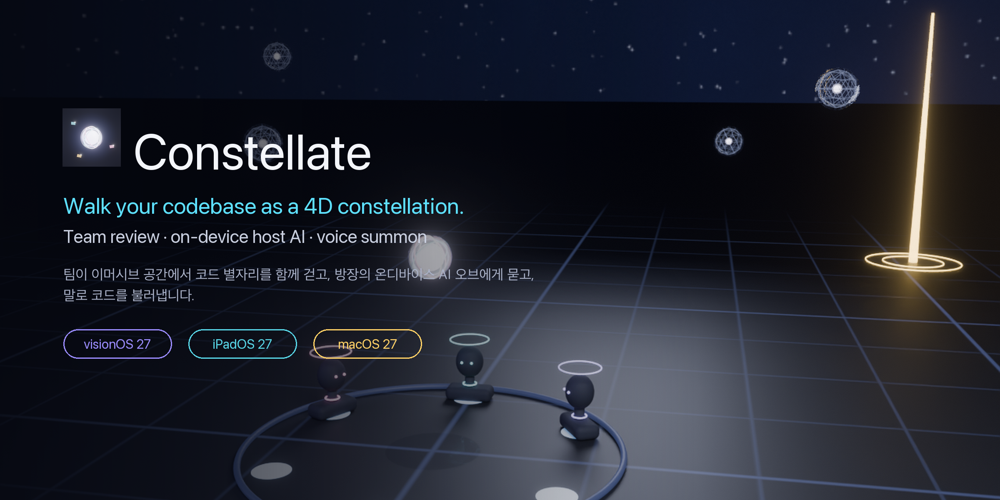
</p>

# Constellate

**Walk your codebase as a constellation — together, with an on-device AI host.**

Constellate turns a whole project into a 4-D "code constellation" inside an immersive space (visionOS) or a RealityKit viewport (iPadOS / macOS). Every file and type is placed by rule — tree depth becomes shell radius, siblings share angular sectors, architecture layer becomes height, and recency becomes a fourth axis you scrub with a time dial. The host's Apple Intelligence model lives in the space as a Siri-like orb: tap a cluster of code and the orb docks into it to answer with that code as context; pull it out and it follows you again. Say *"Constellate, find the views that use @State"* and the matching card flies to your hands while a beacon rises for everyone in the SharePlay session. No code ever leaves the device.

<p align="center">
  
  
  
  
  
  
</p>

---

## Features

- **Project ingest, on device** — point at a folder (≤ 4000 files); `ProjectIngestor` builds a `CodeGraph` (module → folder → file → type → member) with imports / inherits / references / calls edges. Swift symbols are extracted with a dependency-free scanner; `CodeGraph+Analysis` gives stats, hubs, entry points and busiest files.
- **4-D constellation layout** — hierarchical radial shells (1.6 m + 1.25 m per depth), weighted angular sectors that preserve the tree, architecture-layer height bands, card radius `0.08 + √lines/90` m, and a continuous **time dial** (−1…1) that bulges recently changed code outward. Deterministic; same project, same sky.
- **Orbs for any unit of code** — group by folder / file / type / feature (`ClusterGranularity`); each cluster is a glass orb at its centroid that unfolds into code cards.
- **Host AI orb (dock / undock)** — the host's `FoundationModels` session is embodied as a Siri-like orb with five tools: `LocateCode`, `ExplainNode`, `SummarizeCluster`, `ReviewNode`, `PlanTour`, answering with `@Generable` `LocateAnswer` / `TourAnswer`. Tap a cluster to dock the orb into it; drag it out to free it. `HeuristicHost` keeps every feature working when the model is unavailable.
- **Voice summon** — "Constellate" / "콘스텔" wake word via `SpeechAnalyzer`; `VoiceCommandRouter` picks the intent, the found card flies to you, a 3 m beacon rises at its origin, and the beacon is synchronized to all participants.
- **Meetings over SharePlay** — `GroupActivity` host + members, three modes (analysis / review / lecture), **review pins**, **guided tours** with follow-host, stylized bust avatars on a stage ring. Members ask the host AI through the `hostSpeech("ask: …")` relay.
- **Rule-based themes** — `ConstellateTheme.dark` and `tinted(hue:)` presets (Ocean, Moss, Ember, Nebula). Environment stays dark and desaturated (chroma ≤ 0.16, L ≤ 0.30) and automatically avoids code hues; `validate()` enforces it in tests.
- **Privacy by construction** — parsing, AI inference and speech recognition all run on device. SharePlay carries node IDs, text and numbers only; source bodies are never transmitted.

## Platforms

| | visionOS 27 | iPadOS 27 | macOS 27 |
|---|---|---|---|
| Constellation | `ImmersiveSpace` (progressive), you stand at the origin | `RealityView` in a window + orbit camera | `RealityView` in a window + orbit camera (scroll-wheel zoom) |
| Host orb | Life-size in the space, 0.9 m in front of you, head-tracked | In the viewport + HUD | Same |
| Input | Gaze + pinch, hand drag, voice | Touch, Apple Pencil, voice | Mouse, keyboard, voice |
| Meeting | SharePlay with spatial Personas | SharePlay | SharePlay |
| Windows | Dashboard + Code Inspector | 3-column split | 3-column split + menu bar |

One multiplatform app target + the pure-Swift `ConstellateKit` package (Foundation + simd only, 54 tests in 9 suites).

## Screenshots

<table>
  <tr>
    <td align="center">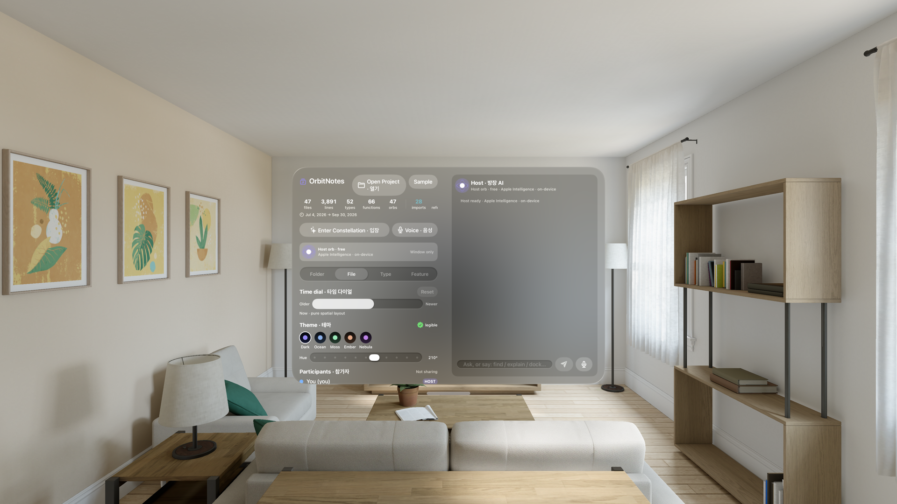<br/><sub>Vision Pro simulator · Dashboard window</sub></td>
    <td align="center">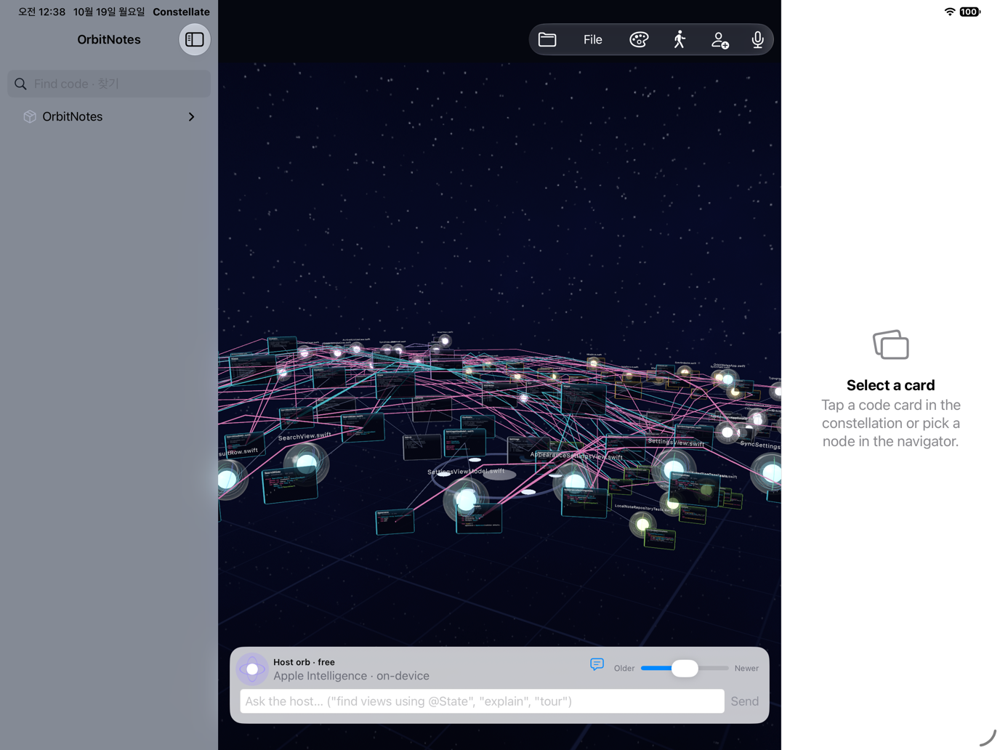<br/><sub>iPad · constellation viewport (landscape)</sub></td>
  </tr>
  <tr>
    <td align="center">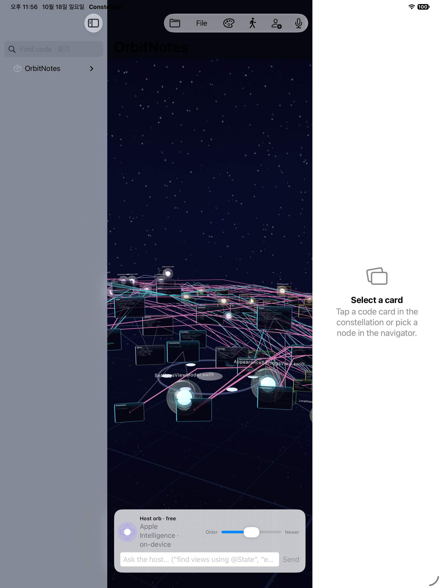<br/><sub>iPad · portrait</sub></td>
    <td align="center">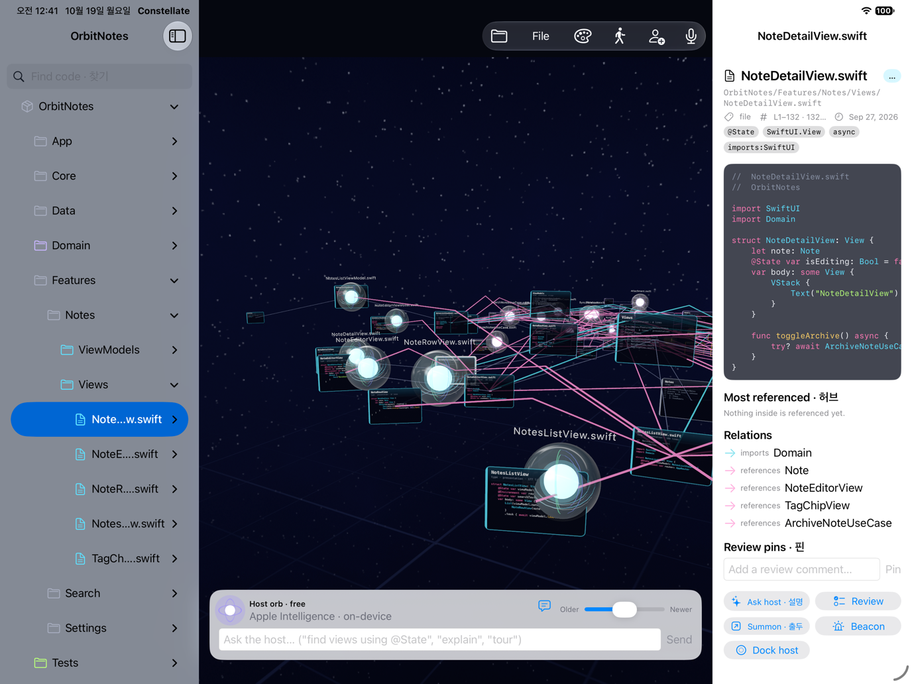<br/><sub>iPad · code inspector</sub></td>
  </tr>
  <tr>
    <td align="center">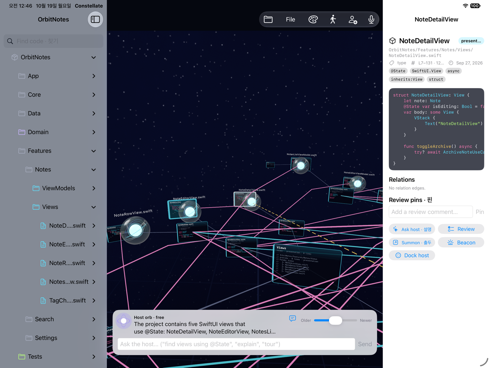<br/><sub>iPad · summon: beacon + card copy</sub></td>
    <td align="center">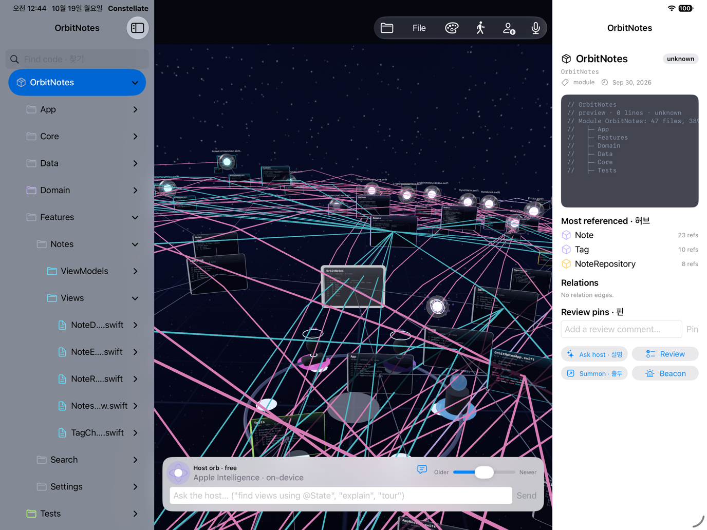<br/><sub>iPad · meeting mode, bust avatars</sub></td>
  </tr>
  <tr>
    <td align="center">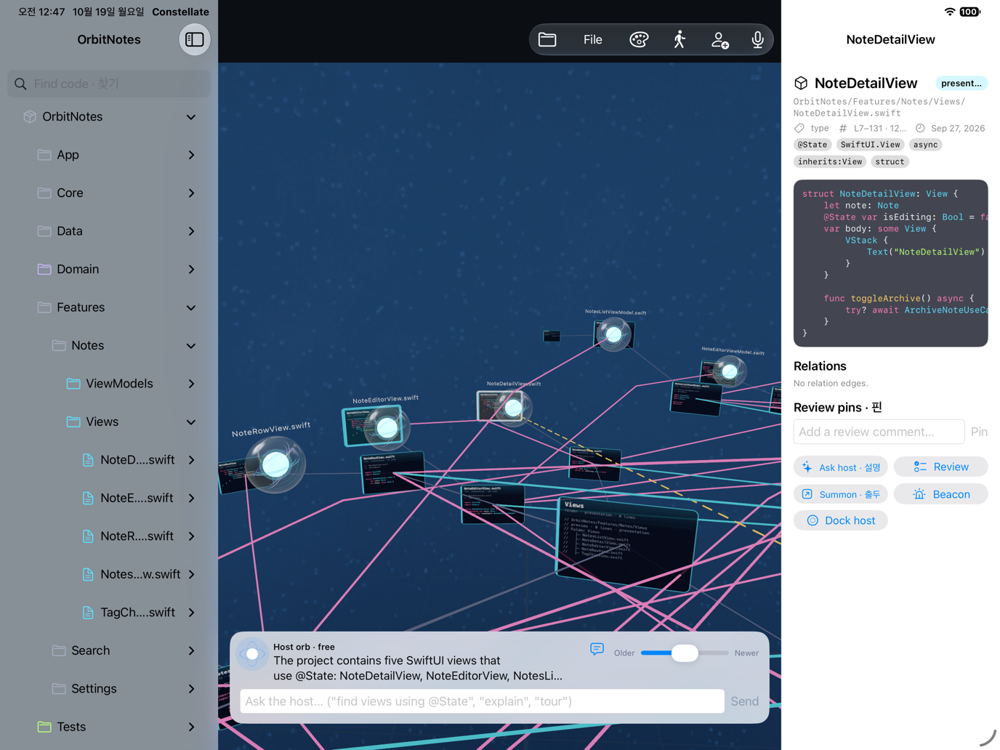<br/><sub>iPad · Ocean tinted theme</sub></td>
    <td align="center">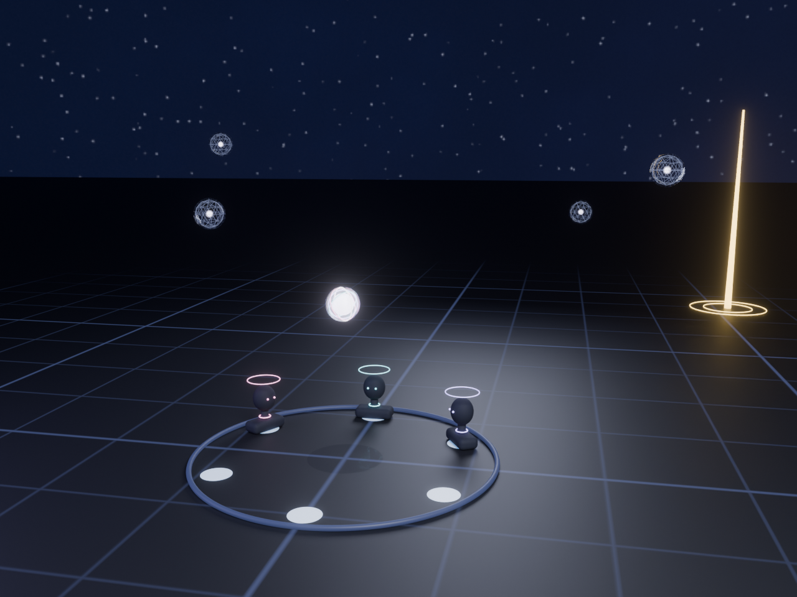<br/><sub>Blender render · Dark theme scene</sub></td>
  </tr>
</table>

<table>
  <tr>
    <td align="center">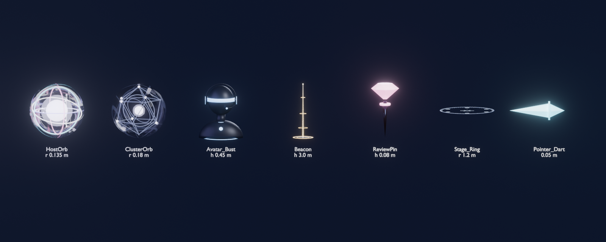<br/><sub>Asset sheet (7 USDZ)</sub></td>
    <td align="center">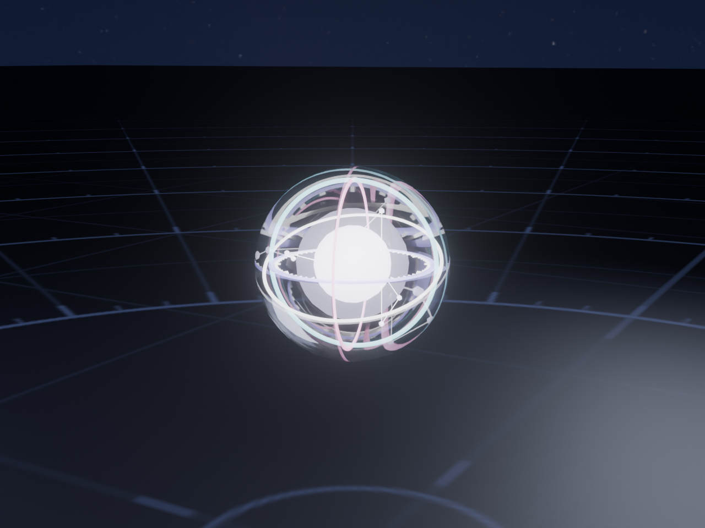<br/><sub>HostOrb.usdz</sub></td>
    <td align="center">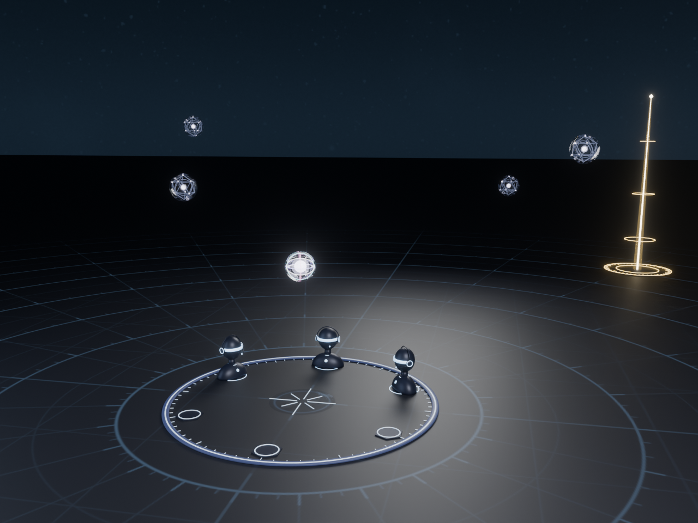<br/><sub>Blender render · Ocean</sub></td>
  </tr>
</table>

> **macOS screenshot pending** — the shell used for this session has no Screen Recording permission, so the macOS build (which compiles and runs) could not be captured yet. It will be added as `Docs/images/screenshot-macos.png`.

## Architecture

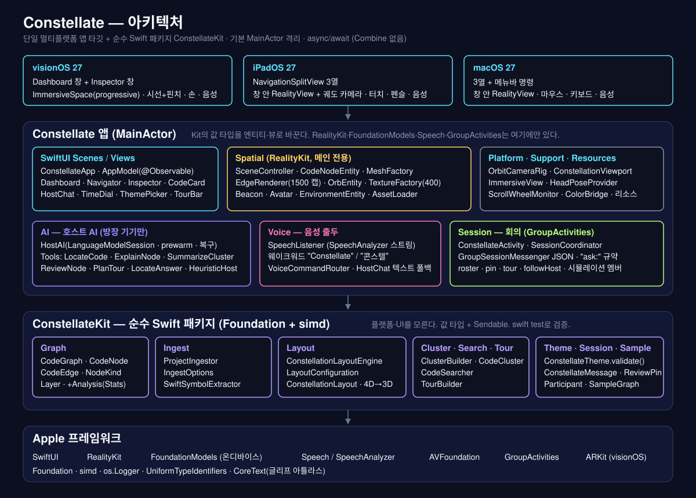

- **Constellate app** — `App/` (`ConstellateApp`, `AppModel`), `Views/` (Dashboard, Navigator, Inspector + CodeInspectorWindow, CodeCard, HostChat, ThemePicker, TimeDial, Participants, TourBar, VoiceButton), `Spatial/` (ConstellationSceneController, CodeNodeEntity, OrbEntity, BeaconEntity, AvatarEntity, EnvironmentEntity, EdgeRenderer, MeshFactory, TextureFactory, AssetLoader), `Platform/` (OrbitCameraRig, ConstellationViewport, ConstellationImmersiveView + HeadPoseProvider, ScrollWheelMonitor), `AI/` (HostAI, HeuristicHost), `Voice/` (SpeechListener, VoiceCommandRouter), `Session/` (ConstellateActivity, SessionCoordinator), `Support/` (ColorBridge, SourceProvider, SyntaxHighlighter).
- **ConstellateKit** — `CodeGraph` (+Analysis), `ProjectIngestor` / `SwiftSymbolExtractor`, `ConstellationLayoutEngine` / `ConstellationLayout`, `ClusterBuilder`, `CodeSearcher`, `TourBuilder`, `ConstellateTheme`, session models (`Participant`, `ReviewPin`, `LearningTour`, `ConstellateMessage`), `SampleGraph.orbitNotes()` (47 files, 15 folders, 50+ types).

More diagrams: [data flow](Docs/diagrams/dataflow.svg) · [4-D layout](Docs/diagrams/layout-4d.svg) · [session topology](Docs/diagrams/session-topology.svg) · [host orb states](Docs/diagrams/orb-states.svg).

## How it works

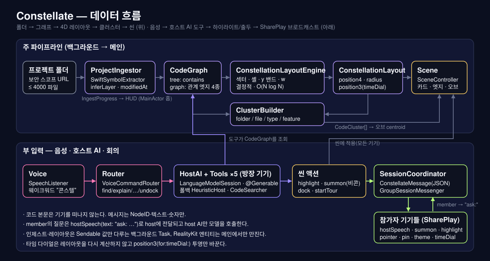

1. **Ingest** — `ProjectIngestor.ingest(rootURL:)` walks the folder on a background task, extracts Swift symbols, infers architecture layers and records modification dates → `CodeGraph`.
2. **4-D layout** — `ConstellationLayoutEngine.layout(_:)` assigns every spatial node `position4 = (x, y, z, w)`: shell radius from depth, sector angle from subtree weight, height from layer, `w` from recency. `ConstellationLayout.position3(for:timeDial:)` projects to 3-D continuously; the scene never re-lays out when you turn the dial.
3. **Orbs** — `ClusterBuilder` groups nodes at the chosen granularity; each `CodeCluster` becomes an orb at `layout.centroid(of:)`. The scene shows up to 2500 node entities and 400 bespoke code textures (the rest are solid layer-coloured cards).
4. **Host AI** — on the host device, `HostAI` wraps a `LanguageModelSession` with five tools grounded in the graph (`CodeSearcher`, `TourBuilder`, `GraphStats`). Docking a cluster puts its code into the prompt context; context-window overflow starts a fresh session once, then falls back. If the model is unavailable, `HeuristicHost` answers from the same Kit calls.
5. **Voice summon** — `SpeechListener` transcribes with `SpeechAnalyzer`, the wake word gates listening, `VoiceCommandRouter` picks the intent, and the result raises a `BeaconEntity` plus a summoned card copy.
6. **SharePlay** — `SessionCoordinator` broadcasts `ConstellateMessage` values as JSON (highlight, summon, orbDock, hostSpeech, pointer, pin, theme, timeDial, mode, tour, followHost). Members ask the host AI through `hostSpeech(text: "ask: …")`.

## Getting started

Requirements: **Xcode 27**, macOS 27. Apple Intelligence and `SpeechAnalyzer` models are only available on devices (not in simulators) — the app falls back to heuristic answers and text input there.

```sh
git clone https://github.com/kimminung/Constellate.git
cd Constellate
open Constellate.xcodeproj          # pick the Constellate scheme and a visionOS / iPad / Mac destination

Scripts/build.sh all                # build macOS + iPadOS simulator + visionOS simulator (exit=0 ×3)
cd ConstellateKit && swift test     # 54 tests / 9 suites
```

The app opens with the built-in **Orbit Notes** sample project (47 files), so you can explore a constellation before granting folder access.

## Blender asset pipeline

All 3-D assets, textures, renders and the app icon are produced headlessly by Blender 5.2 from `Blender/scripts/` (no `.blend` files are kept — see `Blender/scripts/README.md`):

```sh
BLENDER=/Applications/Blender.app/Contents/MacOS/Blender
cd Blender/scripts
$BLENDER --background --python build_all.py        # assets → textures → renders → icon (~15 min; sky render ~9 min)
./make_icon_set.sh                                 # icon_16…1024 + Docs/images/icon-256.png
$BLENDER --background --python build_textures.py -- --fallback   # numpy sky in seconds instead of Cycles
```

| Script | Output |
|---|---|
| `constellate_lib.py` | shared palette / materials / USDZ export + verification / PNG writer |
| `build_assets.py` | `Constellate/Resources/Assets3D/{HostOrb,ClusterOrb,Avatar_Bust,Beacon,ReviewPin,Stage_Ring,Pointer_Dart}.usdz` |
| `build_textures.py` (`--fallback`, `--derived-only`) | `Resources/Textures/{Sky_Dark,Sky_Tint,Floor_Grid}.png` |
| `render_assets.py` | `Blender/renders/*.png` + `AppIcon-1024.png` |
| `build_all.py` (`--skip-*`, `--fallback-sky`) | everything above |

Material slots are fixed (`Core`, `Band0…Band3`, `Shell`, `Accent`, `Glass`, `Base`) so the app swaps them for theme-driven materials at runtime; every USDZ passes `usdchecker --arkit`. Blender 5.2 ignores the Principled Alpha socket, so the exporter post-processes `inputs:opacity` with the bundled `pxr`. `Sky_Dark.png` is a Cycles render (4096×2048, 32 samples, denoise off to keep 1–2 px stars); presentation renders use AgX + bloom. The Blender MCP server was not connected in this session, so the CLI path was used — the same scripts run unchanged under MCP `execute_blender_code`. If assets are missing the app uses procedural fallbacks.

## Roadmap

From `Docs/TASKS-Constellate.md` (2026-10-19):

- [x] **M0** — project skeleton, `ConstellateKit` API contract, theme rules + tests, VISION / PRDs / diagrams, Blender pipeline, first build on all three platforms
- [x] **M1** — Kit: symbol extractor, ingestor, radial shell layout, clusters (4 granularities), EN/KO structural search, tour builder, Orbit Notes sample, graph analysis — 54 tests pass
- [x] **M2** — constellation scene: node entities + textures, edges, environment, orbit camera (iPad/Mac), immersive space (visionOS), time dial, themes
- [x] **M3** — cluster orbs, host orb presence, dock / undock, navigator, inspector + code window
- [ ] **M4** — host AI: session, five tools, `@Generable` answers, fallback, context recovery *(implemented; **no streaming yet**; real-device Apple Intelligence validation pending)*
- [ ] **M5** — voice: `SpeechAnalyzer` listener, wake words, intent router, beacons, summon *(implemented; TTS and real-device validation pending; one `installTap` deprecation warning)*
- [ ] **M6** — meetings: GroupActivities, roles, `ask:` relay, follow-host, pins, tours, avatars *(implemented with simulated members; **laser pointer not yet bound to a gesture**, avatar `Accent` material not yet retinted, graph-chunk sync missing; 2-device validation pending)*
- [ ] **M7** — performance budget (90 fps visionOS, 1500 edges, 2500 nodes / 400 textures), accessibility, macOS screenshot, device validation

## Credits

Constellate consolidates three earlier experiments by the same author:

- **Immersive Code Calligram IDE** — glyph atlas single-mesh text, iridescent ShaderGraph, procedural sky dome, debounced async execution.
- **CoulsonAndJarvis** — the Siri-like orb entity and presence state machine, FoundationModels session wrapper with fallback, SpeechAnalyzer wake-word pipeline, summon-to-front behaviour.
- **CodeFlow3D** — graph / anchor / edge model, continuous tilt projection (now the time dial), single-canvas edge rendering with particles, layer-band colours, review pins.

Author: 김민웅 (Minung Kim, "Coulson") — [github.com/kimminung/Constellate](https://github.com/kimminung/Constellate)

## License

Apache License 2.0 — see [LICENSE](LICENSE). Copyright 2026 Minung Kim (Coulson).

---

# Constellate (한국어)

**팀이 이머시브 공간에 들어가, 프로젝트 전체 코드가 4차원 규칙으로 뿌려진 "코드 별자리"를 함께 걸으며 분석·리뷰·교육 회의를 하는 앱.**

프로젝트 폴더 하나를 열면 모든 파일과 타입이 규칙대로 공간에 배치됩니다 — 트리 깊이는 셸 반지름, 형제는 각도 섹터, 아키텍처 레이어는 높이, 최근 수정도는 네 번째 축(타임 다이얼)이 됩니다. 방장(host) 기기의 온디바이스 Apple Intelligence가 Siri형 오브로 떠 있다가, 코드 뭉치(클러스터) 오브를 탭하면 그 안으로 들어가 그 코드를 컨텍스트로 답하고, 잡아당기면 다시 분리되어 따라다닙니다. "콘스텔, @State를 쓰는 뷰 찾아줘"라고 말하면 해당 카드가 손 앞으로 출두하고, 원래 자리에 솟은 비콘이 SharePlay 참가자 모두에게 동기화됩니다. 코드는 기기를 떠나지 않습니다.

### 현재 상태 (2026-10-19)

- `ConstellateKit` 구현·테스트 완료 — **54 테스트 / 9 스위트** 통과 (`cd ConstellateKit && swift test`)
- 앱이 **macOS · iPadOS · visionOS** 3 플랫폼에서 빌드 (`Scripts/build.sh all` → exit=0 ×3)
- Blender 5.2 헤드리스 파이프라인으로 USDZ 7종(`usdchecker --arkit` 통과)·텍스처 3종·렌더 10종·앱 아이콘 생성
- 남은 것: 응답 스트리밍, 레이저 포인터 제스처 바인딩, 아바타 `Accent` 재틴트, 그래프 청크 동기화, `installTap` 경고, **실기기 검증**(Vision Pro·2기기 SharePlay·Apple Intelligence), macOS 스크린샷(화면 기록 권한 대기)

### 핵심 기능

| 기능 | 설명 |
|---|---|
| 온디바이스 인제스트 | 폴더(≤ 4000 파일) → `CodeGraph`(module→folder→file→type→member + imports/inherits/references/calls 엣지). SwiftSyntax 없는 경량 심볼 추출, `CodeGraph+Analysis` 통계·허브·엔트리 포인트 |
| 4D 별자리 레이아웃 | 계층 방사형 셸(1.6 m + 1.25 m/깊이) · 가중 섹터로 트리 보존 · 레이어 밴드 높이 · 카드 반지름 `0.08 + √lines/90` · 연속 **타임 다이얼**(−1…1) |
| 임의 단위 오브 | folder / file / type / feature 그래뉼래리티. 클러스터마다 유리 오브, 탭하면 카드가 펼쳐짐 |
| 호스트 AI 오브 (dock/undock) | `FoundationModels` 도구 5종 `LocateCode` `ExplainNode` `SummarizeCluster` `ReviewNode` `PlanTour`, `@Generable` `LocateAnswer`/`TourAnswer`. 모델 불가 시 `HeuristicHost` 폴백으로 기능 유지 |
| 음성 출두 | `SpeechAnalyzer` 웨이크워드 "콘스텔"/"Constellate" → `VoiceCommandRouter` → 카드 소환 + 3 m 비콘, 참가자 전원 동기화 |
| 회의 (SharePlay) | host + member, analysis / review / lecture 모드, **리뷰 핀**, **가이드 투어**(follow-host), 흉상 아바타 + 스테이지 링, `ask:` 질문 전달 규약 |
| 규칙 기반 테마 | `dark` + `tinted(hue:)` 프리셋(Ocean·Moss·Ember·Nebula). 환경 chroma ≤ 0.16, L ≤ 0.30, 코드 hue 자동 회피. `validate()`를 테스트로 강제 |
| 개인정보 | 파싱·AI·음성 전부 온디바이스. SharePlay 메시지는 ID·텍스트·숫자만 |

### 동작 원리

인제스트 → 4D 레이아웃 → 오브 → 호스트 AI → 음성 출두 → SharePlay. 자세한 내용은 영어 절 "How it works"와 `Docs/PRD-Tech-Constellate.md` §4·§5를 참고하세요.

### 시작하기

Xcode 27에서 `Constellate.xcodeproj`를 열고 Constellate 스킴을 visionOS / iPad / Mac 대상으로 실행합니다. 명령줄: `Scripts/build.sh all`(3 플랫폼 빌드), `cd ConstellateKit && swift test`(Kit 테스트). 시뮬레이터에는 Apple Intelligence·SpeechAnalyzer 모델이 없으므로 휴리스틱 답변과 텍스트 입력으로 대체됩니다. 내장 샘플 **Orbit Notes**(47 파일)가 기본으로 열립니다.

### Blender 에셋

`Blender/scripts/build_all.py`를 Blender 5.2 헤드리스로 실행하면 `Constellate/Resources/Assets3D/*.usdz`, `Resources/Textures/*.png`, `Blender/renders/*.png`, 앱 아이콘이 생성됩니다(`constellate_lib.py`, `build_assets.py`, `build_textures.py`, `render_assets.py`, `make_icon_set.sh`). 머티리얼 슬롯(`Core` `Band0…Band3` `Shell` `Accent` `Glass` `Base`)은 고정되어 앱이 런타임에 교체합니다. 이번 세션에는 Blender MCP가 연결되지 않아 CLI 경로를 썼고, 같은 스크립트를 MCP `execute_blender_code`로도 실행할 수 있습니다. 자세한 내용은 `Docs/PRD-Design-Constellate.md` §9–10과 `Blender/scripts/README.md`.

### 문서

- `Docs/VISION.md` — 공유 스펙
- `Docs/PRD-Tech-Constellate.md` — 기술 PRD (FR/NFR, 아키텍처, 데이터 모델, 리스크, 마일스톤, 오픈 이슈)
- `Docs/PRD-Design-Constellate.md` — 디자인 PRD (색 체계, 치수, 오브·아바타·이펙트, 에셋 명세, Blender 파이프라인, 접근성, 모션)
- `Docs/TASKS-Constellate.md` — 마일스톤별 태스크, 알려진 갭, 검증 매트릭스, 회귀 확인 명령
- `Docs/diagrams/` — 아키텍처·데이터 흐름·4D 레이아웃·세션 토폴로지·오브 상태기계 (SVG/PNG)

### 출처

Immersive Code Calligram IDE(글리프 아틀라스·스카이돔), CoulsonAndJarvis(Siri형 오브·FoundationModels·SpeechAnalyzer), CodeFlow3D(그래프 모델·연속 투영·엣지 렌더·리뷰 핀) 세 프로젝트를 통합했습니다.

작성자: 김민웅(콜슨) · 라이선스 Apache-2.0
