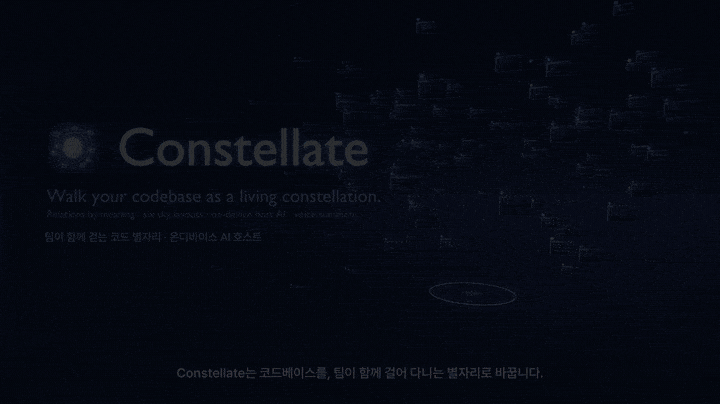
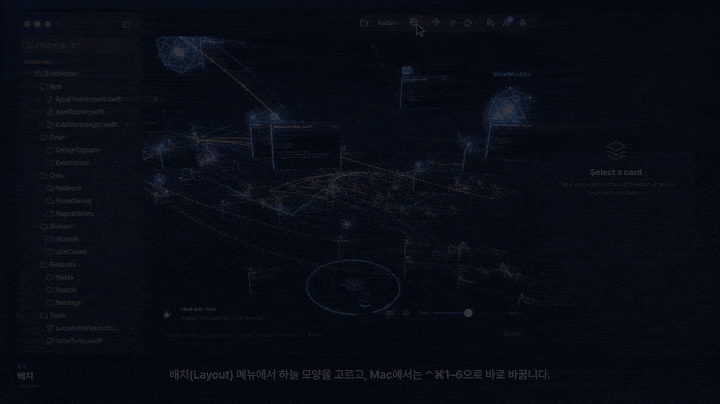
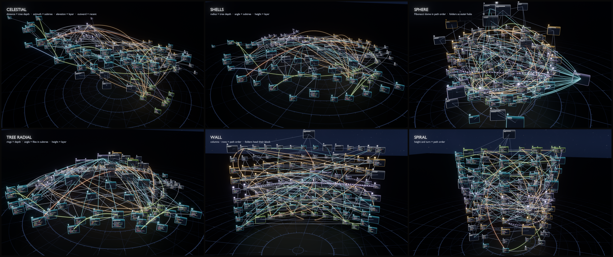
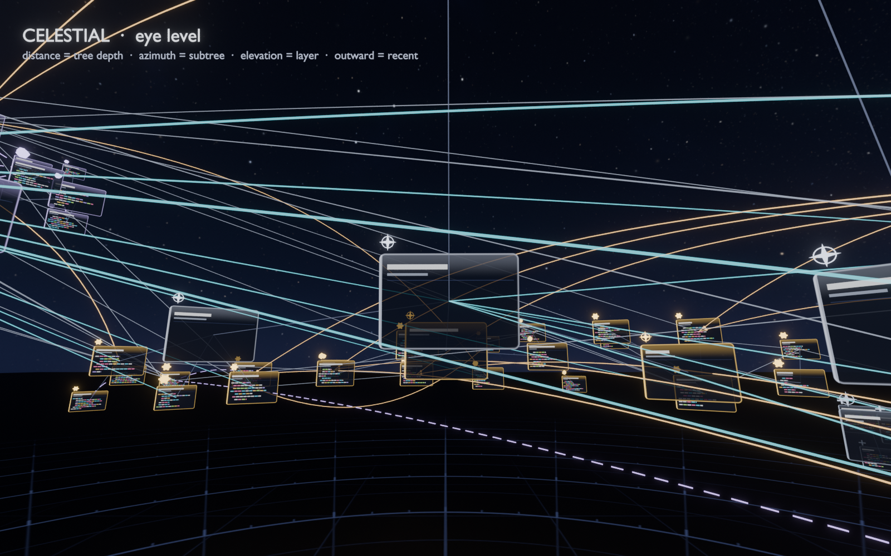
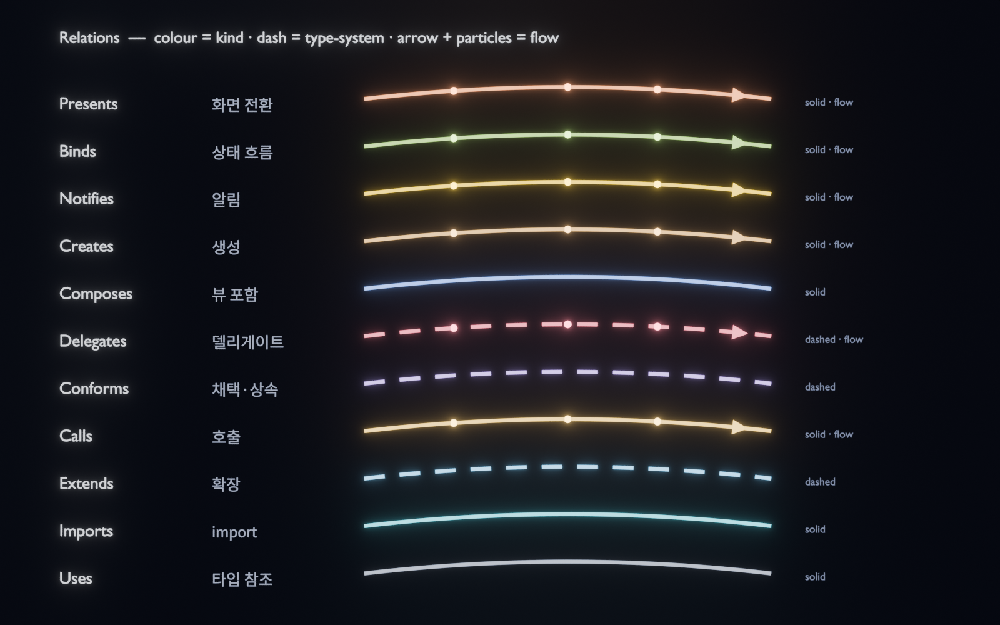
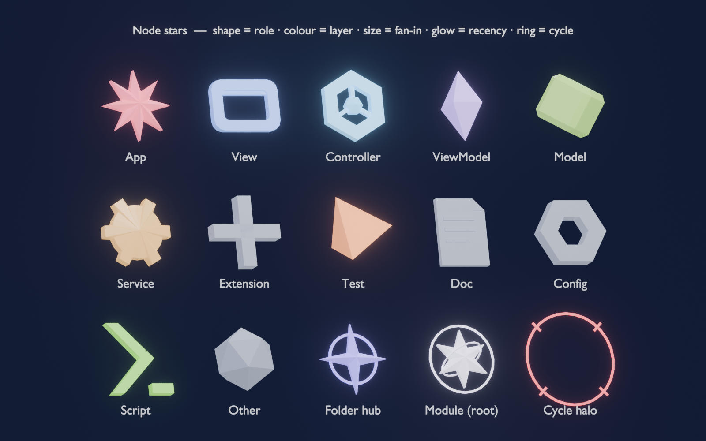
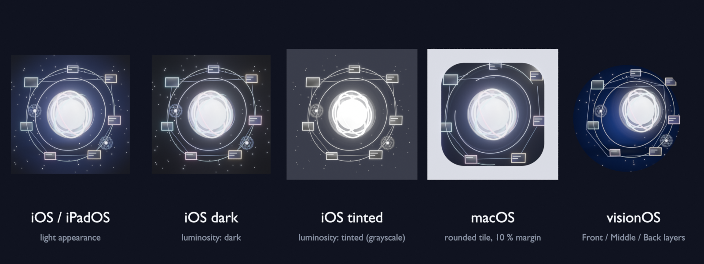

<p align="center">
  
</p>

# Constellate

**코드베이스를 별자리처럼 걸어 다니며, 온디바이스 AI 호스트와 함께 분석·리뷰·교육 회의를 하는 앱.**

Constellate는 프로젝트 전체를 이머시브 공간(visionOS) 또는 RealityKit 뷰포트(iPadOS / macOS) 안의 다차원 "코드 별자리"로 바꿉니다. 모든 파일과 타입은 규칙대로 자리를 잡습니다 — 기본 *천구* 배치에서는 트리 깊이가 거리, 서브트리가 방위 섹터, 아키텍처 레이어가 고도각(UI는 머리 위, 데이터는 지평선, 테스트는 아래)이 되고, 최근 수정도는 타임 다이얼로 문지르는 네 번째 축이 됩니다. 관계는 *의미*로 그려집니다 — 화면이 다른 화면을 띄우고, 뷰가 모델을 관찰하고, 팩토리가 타입을 생성하는 관계가 저마다의 색·선 모양·3D 레인을 갖고, 카드마다 떠 있는 별의 모양·색·크기·발광이 역할·레이어·결합도·최근성을 말해 줍니다. 호스트의 Apple Intelligence 모델은 Siri 같은 오브로 공간에 떠 있다가, 코드 뭉치를 탭하면 그 안으로 도킹해 그 코드를 문맥으로 답하고, 끌어내면 다시 따라다닙니다. *"콘스텔, @State 쓰는 뷰 찾아줘"*라고 말하면 해당 카드가 손 앞으로 날아오고 SharePlay 참가자 모두에게 비콘이 솟습니다. 코드는 기기를 떠나지 않습니다.

**호스트 AI·음성 인식·화면 문구는 한국어가 기본**입니다. 영어 모드는 설정 → 고급 → 언어에서 켤 수 있습니다. ([English README](README.en.md))

<p align="center">
  
  
  
  
  
  
</p>


## 영상


https://github.com/user-attachments/assets/d40ddac7-933e-4bdb-ade7-8c2d3a3e634b


https://github.com/user-attachments/assets/f2b20f89-7dee-4529-a0c7-a5d3a715d37f


<table>
  <tr>
    <td align="center" width="50%"><a href="Docs/video/constellate-intro.mp4"></a><br/><sub><b>앱 소개</b> · 1:43 · <a href="Docs/video/constellate-intro.mp4">MP4</a></sub></td>
    <td align="center" width="50%"><a href="Docs/video/constellate-howto.mp4"></a><br/><sub><b>사용법</b> · 2:04 · <a href="Docs/video/constellate-howto.mp4">MP4</a></sub></td>
  </tr>
</table>

한국어 내레이션과 자막, 자체 제작 음악. 사용법 영상의 Mac 창은 Orbit Notes 샘플을 기준으로 SwiftUI 소스에서 다시 만든 것입니다(실기기 녹화는 아직 준비 중). 두 영상의 제작 과정: [Docs/video](Docs/video/README.md).

<!-- 인라인 플레이어: github.com에서 이 README를 편집하고 Docs/video/constellate-intro.mp4 와 constellate-howto.mp4 를
     아래 줄에 끌어다 놓은 뒤 커밋하세요. GitHub가 파일을 업로드하고 여기서 바로 재생되는
     https://github.com/user-attachments/assets/… 줄을 삽입합니다. -->

---

## 기능

- **온디바이스 프로젝트 인제스트** — 폴더(≤ 4000 파일)를 가리키면 `ProjectIngestor`가 `CodeGraph`(module → folder → file → type → member)와 imports / inherits / references / calls 엣지를 만듭니다. Swift 심볼은 의존성 없는 스캐너로 추출하고, `CodeGraph+Analysis`가 통계·허브·진입점·가장 바쁜 파일을 알려 줍니다.
- **별자리 모양 6종** — `celestial`(기본: 눈 주위의 구면 셸 — 깊이 → 거리, 서브트리 → 방위, 레이어 → 고도), v1의 `shells` 원반, 그리고 CoulsonPortfolioWeb에서 포팅한 `sphere`(폴더 패치가 있는 피보나치 돔), `treeRadial`, `wall`(눈앞의 곡면 벽), `spiral`. 가중 섹터가 트리를 보존하고, 카드 반지름은 `0.08 + √lines/90` m, 연속 **타임 다이얼**(−1…1)이 최근 코드를 바깥으로 밀어냅니다(돔 스타일은 구면 방향으로). 결정적 — 같은 프로젝트면 같은 하늘. 툴바, visionOS 대시보드, ⌃⌘1…6으로 전환하며 호스트의 선택은 SharePlay로 동기화됩니다.
- **의미로 그리는 관계** — `RelationClassifier`(포트폴리오 `relations.js` 포팅)가 모든 참조에 이름을 붙입니다: **화면 전환**(sheet / NavigationLink / WindowGroup), **상태 흐름**(@State / @Environment / @Bindable — 원본에서 뷰 방향으로), **뷰 포함**, **생성**, **채택·상속**, **확장**, **델리게이트**, **알림**, **호출**, **import**, **타입 참조**. 종류마다 고정 색, 점선/실선, 데이터가 흐르는 곳의 흐름 파티클과 화살표, 그리고 코드 사이 호를 현 주위로 회전시킨 전용 *레인*이 있어 같은 두 카드 사이의 서로 다른 관계가 3D에서 분리됩니다. 끔 / 선택 / 전체(⌘L)와 종류를 숨기는 범례; 카드를 선택하면 관련 없는 것은 모두 어두워집니다. 관계는 검색도 됩니다 — *"SettingsView를 띄우는 뷰"*, *"NotesListView가 관찰하는 상태"*, *"views that present SettingsView"* — 내비게이터, 음성, 호스트 AI의 `locateCode` 도구 어디서나.
- **별, 결합도, 순환** — 카드 위 글리프가 역할(App, View, ViewModel, Model, Service, Test… `inferRole`에서), 레이어 색, fan-in 크기, 최근성 발광을 인코딩합니다. `GraphInsights`가 의존성을 파일 단위로 끌어올립니다: fan-in / fan-out, 불안정도, 전이적 영향 범위, Tarjan 순환 — 순환에 속한 파일을 고르면 고리 전체가 빨갛게 켜집니다. 인스펙터는 관계를 "띄우는 화면 / 관찰하는 뷰 / 생성하는 곳 …"으로 묶고, 호스트 AI도 같은 요약을 문맥으로 받습니다.
- **어떤 단위든 오브로** — 폴더 / 파일 / 타입 / 기능(`ClusterGranularity`)으로 묶기; 클러스터마다 중심에 유리 오브가 있고 탭하면 코드 카드로 펼쳐집니다.
- **호스트 AI 오브 (도킹 / 분리)** — 호스트의 `FoundationModels` 세션이 Siri형 오브로 구현되어 다섯 가지 도구(`LocateCode`, `ExplainNode`, `SummarizeCluster`, `ReviewNode`, `PlanTour`)로 `@Generable` `LocateAnswer` / `TourAnswer`를 답하고, 자유 대화는 토큰 단위로 스트리밍됩니다(`HostAI.streamChat`). **한국어 지시문으로 한국어로 답하며**, 설정에서 영어로 바꾸면 세션이 새 지시문으로 다시 만들어집니다. 클러스터를 탭하면 오브가 그 안에 도킹하고, 끌어내면 풀려납니다. 모델을 쓸 수 없을 때는 `HeuristicHost`가 같은 언어로 모든 기능을 유지합니다.
- **음성 출두 + 음성 답변** — `SpeechAnalyzer`의 "콘스텔" / "Constellate" 웨이크 워드; 인식 언어는 설정 언어(기본 ko_KR, 모델이 없으면 en_US로 폴백)를 따릅니다. `VoiceCommandRouter`가 의도를 고르면 찾은 카드가 날아오고, 원래 자리에 3 m 비콘이 솟아 모든 참가자에게 동기화됩니다. `HostVoice`가 답변을 읽어 줍니다(한글이면 ko-KR, 아니면 en-US, 토글은 저장됨).
- **SharePlay 회의** — `GroupActivity` 호스트 + 참가자, 세 가지 모드(분석 / 리뷰 / 강의), **레이저 포인터**(iPad/Mac 길게 누르기 + 드래그, visionOS 핀치 유지), Markdown으로 내보내는 **리뷰 핀**, 호스트 따라가기가 되는 **가이드 투어**(iPad/Mac은 카메라가 출두·투어 노드로 날아가고, visionOS는 빛나는 안내 화살표), 참가자 강조색으로 다시 칠한 흉상 아바타와 스테이지 링. 참가자는 `hostSpeech("ask: …")` 릴레이로 호스트 AI에게 질문합니다.
- **규칙 기반 테마** — `ConstellateTheme.dark`와 `tinted(hue:)` 프리셋(오션, 모스, 엠버, 네뷸라). 환경은 어둡고 채도가 낮게 유지되며(chroma ≤ 0.16, L ≤ 0.30) 코드 색상을 자동으로 피합니다. `validate()`가 테스트로 이를 강제합니다.
- **설계부터 프라이버시** — 파싱, AI 추론, 음성 인식 모두 기기 안에서 실행됩니다. SharePlay는 노드 ID·텍스트·숫자만 나르며 소스 본문은 절대 전송하지 않습니다.

## 언어 설정

| 항목 | 한국어(기본) | English |
|---|---|---|
| 호스트 AI 지시문 · 도구 프롬프트 | 한국어로 답하고 코드 식별자는 원문 유지 | Answer in English |
| 휴리스틱 폴백 · 투어 내레이션 · 클러스터 요약 | 한국어 문장 (`TourBuilder`, `ClusterBuilder.heuristicSummary`, `HeuristicHost`) | English sentences |
| 음성 인식 로케일 | ko_KR → en_US → 기기 언어 순으로 폴백 | en_US → ko_KR → 기기 언어 |
| 화면 문구 · 메뉴 · 핀 내보내기 | 한국어 | English |

설정 위치: iPad/Mac 툴바의 ⚙︎ 설정 → **고급** → 언어, visionOS 대시보드의 설정 패널 → **고급**, macOS 메뉴 막대 별자리 → 고급. 값은 `LanguageSetting`(UserDefaults `appLanguage`)에 저장되고 `AppModel.setLanguage`가 AI 세션·음성 인식기·모든 라벨을 한 번에 바꿉니다. Kit에서는 `HostLanguage`(`ko` / `en`)로 전달됩니다.

## 플랫폼

| | visionOS 27 | iPadOS 27 | macOS 27 |
|---|---|---|---|
| 별자리 | `ImmersiveSpace`(progressive), 원점에 서서 봄 | 창 안의 `RealityView` + 궤도 카메라 | 창 안의 `RealityView` + 궤도 카메라(스크롤 휠 줌) |
| 호스트 오브 | 실물 크기, 눈앞 0.9 m, 머리 추적 | 뷰포트 + HUD | 동일 |
| 입력 | 시선 + 핀치, 손 드래그, 음성 | 터치, Apple Pencil, 음성 | 마우스, 키보드, 음성 |
| 회의 | 공간 페르소나 SharePlay | SharePlay | SharePlay |
| 창 | 대시보드 + 코드 인스펙터 | 3열 분할 | 3열 분할 + 메뉴 막대 |

멀티플랫폼 앱 타겟 하나 + 순수 Swift 패키지 `ConstellateKit`(Foundation + simd만, 103 테스트).

## 별자리의 언어

ConstellateKit이 Orbit Notes 샘플에 대해 계산한 위치·호·범례를 Blender가 렌더링했습니다(`Blender/data/*.json` → `render_graph.py`):

<p align="center"></p>

<table>
  <tr>
    <td align="center"><br/><sub>천구 · 서 있는 자리에서</sub></td>
    <td align="center"><br/><sub>관계: 색 = 종류 · 점선 = 타입 시스템 · 화살표 + 파티클 = 흐름</sub></td>
  </tr>
  <tr>
    <td align="center"><br/><sub>별: 모양 = 역할 · 색 = 레이어 · 크기 = fan-in · 발광 = 최근성 · 링 = 순환</sub></td>
    <td align="center"><br/><sub>새 하늘과 아스트롤라베 바닥 위의 회의 에셋 v2</sub></td>
  </tr>
</table>

## 스크린샷

<table>
  <tr>
    <td align="center"><br/><sub>Vision Pro 시뮬레이터 · 대시보드 창</sub></td>
    <td align="center"><br/><sub>iPad · 별자리 뷰포트(가로)</sub></td>
  </tr>
  <tr>
    <td align="center"><br/><sub>iPad · 세로</sub></td>
    <td align="center"><br/><sub>iPad · 코드 인스펙터</sub></td>
  </tr>
  <tr>
    <td align="center"><br/><sub>iPad · 출두: 비콘 + 카드 사본</sub></td>
    <td align="center"><br/><sub>iPad · 회의 모드, 흉상 아바타</sub></td>
  </tr>
  <tr>
    <td align="center"><br/><sub>iPad · 오션 틴트 테마</sub></td>
    <td align="center"><br/><sub>Blender 렌더 · 다크 테마 장면</sub></td>
  </tr>
</table>

<table>
  <tr>
    <td align="center"><br/><sub>에셋 시트(USDZ 7종)</sub></td>
    <td align="center"><br/><sub>HostOrb.usdz</sub></td>
    <td align="center"><br/><sub>Blender 렌더 · 오션</sub></td>
  </tr>
</table>

> **macOS 스크린샷 준비 중** — 이 세션의 셸에는 화면 기록 권한이 없어 macOS 빌드(컴파일·실행은 됨)를 아직 캡처하지 못했습니다. `Docs/images/screenshot-macos.png`로 추가될 예정입니다.

## 아키텍처


- **Constellate 앱** — `App/`(`ConstellateApp`, `AppModel`), `Views/`(Dashboard, Navigator, Inspector + CodeInspectorWindow, CodeCard, HostChat, ThemePicker, TimeDial, Participants, TourBar, VoiceButton, RelationLegend, SettingsMenu), `Spatial/`(ConstellationSceneController, CodeNodeEntity, OrbEntity, BeaconEntity, AvatarEntity, EnvironmentEntity, EdgeRenderer + FlowParticles, NodeStarFactory, FXTextures, MeshFactory, TextureFactory, AssetLoader), `Platform/`(OrbitCameraRig, ConstellationViewport, ConstellationImmersiveView + HeadPoseProvider, ScrollWheelMonitor), `AI/`(HostAI, HeuristicHost), `Voice/`(SpeechListener, VoiceCommandRouter, HostVoice), `Session/`(ConstellateActivity, SessionCoordinator), `Support/`(AppLanguage, ColorBridge, SourceProvider, SyntaxHighlighter, PinsExporter).
- **ConstellateKit** — `CodeGraph`(+Analysis), `RelationKind` / `CodeRole`, `GraphInsights`, `RelationDigest`, `ProjectIngestor` / `SwiftSymbolExtractor` / `RelationClassifier`, `ConstellationLayoutEngine`(`LayoutStyle` 6종) / `ConstellationLayout`, `EdgeSceneBuilder`(관계 튜브, 흐름, 포커스), `StarEncoder`, `ConstellationSnapshot`, `ClusterBuilder`, `CodeSearcher`, `TourBuilder`, `ConstellateTheme`, `HostLanguage`(+ 단일 언어 표시 이름), 세션 모델(`Participant`, `ReviewPin`, `LearningTour`, `ConstellateMessage`), `SampleGraph.orbitNotes()`(47 파일, 15 폴더, 50+ 타입).

더 많은 다이어그램: [데이터 흐름](Docs/diagrams/dataflow.svg) · [4D 배치](Docs/diagrams/layout-4d.svg) · [세션 토폴로지](Docs/diagrams/session-topology.svg) · [호스트 오브 상태](Docs/diagrams/orb-states.svg).

## 동작 원리


1. **인제스트** — `ProjectIngestor.ingest(rootURL:)`가 백그라운드 태스크에서 폴더를 순회하며 Swift 심볼을 추출하고, 아키텍처 레이어와 역할을 추론하고, 모든 참조를 `RelationKind`로 분류하고, 수정 날짜를 기록해 `CodeGraph`를 만듭니다. 이어서 `GraphInsights`가 파일 의존성, 순환, 결합도를 도출합니다.
2. **배치** — `ConstellationLayoutEngine(style:).layout(_:)`이 선택한 스타일대로 모든 공간 노드에 `position4 = (x, y, z, w)`를 부여합니다(천구: 깊이에서 거리, 서브트리 가중치에서 방위, 레이어에서 고도; `w`는 최근성). `ConstellationLayout.position3(for:timeDial:)`이 연속적으로 3D에 투영하므로 다이얼을 돌려도 장면이 다시 배치되지 않습니다.
3. **관계** — `EdgeSceneBuilder`가 관계 엣지를 종류 × 강조별로 병합된 튜브 메시(종류별 레인의 베지어 호, 점선, 화살표)와 파티클 경로로 바꿉니다(메인 액터 밖에서). 앱은 Blender의 `FX_EdgeRamp`로 음영을 입혀 엣지가 목적지 쪽으로 밝아지게 합니다.
4. **오브** — `ClusterBuilder`가 선택한 단위로 노드를 묶고, 각 `CodeCluster`는 `layout.centroid(of:)` 위치의 오브가 됩니다. 장면은 최대 2500개의 노드 엔티티와 400개의 전용 코드 텍스처를 표시합니다(나머지는 레이어 색 단색 카드).
5. **호스트 AI** — 호스트 기기에서 `HostAI`가 그래프에 근거한 다섯 도구(`CodeSearcher`, `TourBuilder`, `GraphStats`)로 `LanguageModelSession`을 감쌉니다. 지시문과 프롬프트는 `HostLanguage`에 따라 한국어/영어로 만들어지고, 언어를 바꾸면 세션이 다시 생성됩니다. 클러스터에 도킹하면 그 코드가 프롬프트 문맥에 들어가고, 컨텍스트 창이 넘치면 한 번 새 세션을 시작한 뒤 폴백합니다. 모델을 쓸 수 없으면 `HeuristicHost`가 같은 Kit 호출로 같은 언어로 답합니다.
6. **음성 출두** — `SpeechListener`가 `SpeechAnalyzer`로 받아쓰고(설정 언어의 로케일 우선), 웨이크 워드가 듣기를 열며, `VoiceCommandRouter`가 의도를 고르고, 결과가 `BeaconEntity`와 출두 카드 사본을 띄웁니다.
7. **SharePlay** — `SessionCoordinator`가 `ConstellateMessage` 값을 JSON으로 브로드캐스트합니다(highlight, summon, orbDock, hostSpeech, pointer, pin, theme, timeDial, mode, tour, followHost, layoutStyle, relationMode). 참가자는 `hostSpeech(text: "ask: …")`로 호스트 AI에게 질문합니다.

## 시작하기

요구 사항: **Xcode 27**, macOS 27. Apple Intelligence와 `SpeechAnalyzer` 모델은 실기기에서만 제공됩니다(시뮬레이터 제외) — 거기서는 휴리스틱 답변과 텍스트 입력으로 대체됩니다. 온디바이스 모델이 한국어를 지원하지 않는 기기에서는 호스트 상태에 "(한국어 미지원 모델)"이 표시되고 답변이 영어로 올 수 있습니다.

```sh
git clone https://github.com/kimminung/Constellate.git
cd Constellate
open Constellate.xcodeproj          # Constellate 스킴과 visionOS / iPad / Mac 대상을 고릅니다

Scripts/build.sh all                # macOS + iPadOS 시뮬레이터 + visionOS 시뮬레이터 빌드 (exit=0 ×3)
cd ConstellateKit && swift test     # 103 테스트 — AppFacingAPITests는 일반 `import`를 쓰므로
                                   # 앱이 호출하는 API가 Kit에서 사라지면 실패합니다 (Xcode 불필요)
```

앱은 내장 **Orbit Notes** 샘플 프로젝트(47 파일)로 열리므로 폴더 접근을 허용하기 전에 별자리를 먼저 둘러볼 수 있습니다.

> **무료 개인 팀으로 Mac에서 실행하기** — Group Activities(SharePlay) 권한은 개인 개발 팀이 macOS에 프로비저닝할 수 없습니다. 그래서 Mac 빌드는 그 항목을 뺀 `Constellate/Constellate-macOS.entitlements`를 씁니다: 타겟 Build Settings의 Code Signing Entitlements에서 Debug/Release 각각 **Any macOS SDK** 행을 추가하고 값을 `Constellate/Constellate-macOS.entitlements`로 두세요. iPad / visionOS는 기존 파일로 SharePlay를 유지합니다.

## Blender 에셋 파이프라인

모든 3D 에셋, 이펙트 스프라이트, 텍스처, 렌더, 앱 아이콘은 `Blender/scripts/`에서 Blender 5.2가 헤드리스로 만듭니다(`.blend` 파일은 보관하지 않음 — `Blender/scripts/README.md` 참고):

```sh
BLENDER=/Applications/Blender.app/Contents/MacOS/Blender
cd Blender/scripts
$BLENDER --background --python build_all.py        # 에셋 → 별 + FX → 텍스처 → 렌더 → 별자리 렌더 → 아이콘
./make_icon_set.sh                                 # mac_1024에서 mac_16…512 + Docs/images/icon-256.png
$BLENDER --background --python build_graph_assets.py              # NodeStars.usdz + FX_*.png 만
$BLENDER --background --python render_graph.py -- --quick         # 배치 갤러리 + 범례, 빠른 미리보기
$BLENDER --background --python build_textures.py -- --fallback    # Cycles 대신 numpy 하늘을 몇 초 만에
```

**v2 "관측 기기"** — 회의 에셋을 정밀한 천문 기기로 다시 설계했습니다(혼천의 호스트 오브, 지오데식 클러스터 오브, 헤드셋을 쓴 바이저 흉상, 트랙터 링과 바닥 메달리온이 있는 비콘, 보석 리뷰 핀, 아스트롤라베 스테이지 링, 크리스털 포인터). 모두 삼각형 예산 안에 있고 ARKit USD 규칙을 통과합니다. 하늘에는 은하수, 먼지 띠, 두 겹의 성운, 네 등급의 별이 있고(여전히 OKLab L ≤ 0.29, chroma ≤ 0.06), 바닥은 배치의 깊이 셸 바로 아래에 링이 놓이는 아스트롤라베입니다.

| 스크립트 | 출력 |
|---|---|
| `constellate_lib.py` | 공용 팔레트 / 머티리얼 / USDZ 내보내기 + 검증 / PNG 작성기 |
| `build_assets.py` | `Constellate/Resources/Assets3D/{HostOrb,ClusterOrb,Avatar_Bust,Beacon,ReviewPin,Stage_Ring,Pointer_Dart}.usdz` |
| `build_graph_assets.py` | `Assets3D/NodeStars.usdz`(별 글리프 15종) + `Textures/FX_{Glow,Spark,Ring,Beam,EdgeRamp,CardGlow}.png` |
| `build_textures.py` (`--fallback`, `--derived-only`, `--sky-only`, `--floor-only`) | `Resources/Textures/{Sky_Dark,Sky_Tint,Floor_Grid}.png` |
| `render_assets.py` | `Blender/renders/*.png`(에셋 + 테마 렌더) |
| `render_graph.py` | `Blender/data/*.json`에서 `Blender/renders/{layout_*,layout_gallery,node_stars,relation_legend}.png` |
| `render_icons.py` | 플랫폼 앱 아이콘: iOS 라이트/다크/틴트, macOS 둥근 타일, visionOS Front/Middle/Back 레이어, `Blender/renders/icon_sheet.png` |
| `build_all.py` (`--skip-*`, `--skip-graph`, `--skip-graph-renders`, `--skip-icons`, `--fallback-sky`) | 위의 전부 |

머티리얼 슬롯은 고정되어 있어(`Core`, `Band0…Band3`, `Shell`, `Accent`, `Glass`, `Base`) 앱이 런타임에 테마 기반 머티리얼로 바꿔 끼웁니다. 모든 USDZ는 ARKit USD 규칙을 통과합니다. Blender 5.2는 Principled Alpha 소켓을 무시하므로 내보내기가 `pxr`로 `inputs:opacity`를 후처리합니다. FX 스프라이트는 강도가 작은 공식(`constellate_lib.Field`)인 발광 평면을 Cycles로 선형 EXR에 렌더링해 흰색 + 알파로 저장하므로 텍스처 하나를 어떤 색으로든 틴트할 수 있습니다. `Sky_Dark.png`는 Cycles 렌더(4096×2048, 12 샘플, 1–2 px 별을 지키려고 디노이즈 끔)이며 프레젠테이션 렌더는 AgX + 블룸을 씁니다. 이 세션에서는 Blender MCP 서버가 연결되지 않아 CLI 경로를 썼고, 같은 스크립트를 MCP `execute_blender_code`로도 그대로 실행할 수 있습니다. 에셋이 없으면 앱은 절차적 폴백을 씁니다.

## 앱 아이콘

모든 플랫폼 아이콘은 한 장면(같은 카메라라 visionOS 레이어가 정렬됨)에서 Blender로 렌더링했습니다: 주인공 호스트 오브, 시안/앰버/핑크 반짝임이 있는 작은 코드 카드 별자리, 클러스터 오브 두 개, 날카로운 별.



| 플랫폼 | 파일 | 비고 |
|---|---|---|
| iOS / iPadOS | `AppIcon-1024.png`, `-dark.png`, `-tinted.png` | `AppIcon.appiconset`의 세 가지 외형(`luminosity` 다크 / 틴트) |
| macOS | `mac_1024.png` → `mac_16…512.png` | 둥근 타일(r 22.4 %), 10 % 여백, 유리 림 라이트 |
| visionOS | `AppIcon.solidimagestack/{Back,Middle,Front}` | Back = 우주 + 별, Middle = 카드 + 클러스터 오브, Front = 호스트 오브; 호버 시 시차 |

## 로드맵

`Docs/TASKS-Constellate.md`(2026-10-19, PR #1과 두 번째 앱 라운드 이후) 기준:

- [x] **M0** — 프로젝트 뼈대, `ConstellateKit` API 계약, 테마 규칙 + 테스트, VISION / PRD / 다이어그램, Blender 파이프라인, 3개 플랫폼 첫 빌드
- [x] **M1** — Kit: 심볼 추출기, 인제스터, 방사형 셸 배치, 클러스터(4 단위), 한/영 구조 검색, 투어 빌더, Orbit Notes 샘플, 그래프 분석 — 54 테스트 통과
- [x] **M2** — 별자리 장면: 노드 엔티티 + 텍스처, 엣지, 환경, 궤도 카메라(iPad/Mac), 이머시브 공간(visionOS), 타임 다이얼, 테마
- [x] **M3** — 클러스터 오브, 호스트 오브 존재감, 도킹 / 분리, 내비게이터, 인스펙터 + 코드 창
- [ ] **M4** — 호스트 AI: 세션, 도구 5종, `@Generable` 답변, 폴백, 컨텍스트 복구, **스트리밍 채팅 답변**, **한국어 우선 지시문 + 언어 설정** *(구현됨; explain/review/summarize 도구 답변은 아직 한 번에 도착; 실기기 Apple Intelligence 검증 대기)*
- [ ] **M5** — 음성: `SpeechAnalyzer` 리스너(ko_KR 우선), 웨이크 워드, 의도 라우터, 비콘, 출두, **TTS(`HostVoice`)** *(구현됨; 실기기 검증 대기; `installTap` 경고 1건)*
- [ ] **M6** — 회의: GroupActivities, 역할, `ask:` 릴레이, **호스트 따라가기 카메라 / 안내 화살표**, **레이저 포인터 제스처**, **해결/삭제 + Markdown 내보내기 핀**, 투어, **강조색 아바타** *(시뮬레이션 참가자로 구현; 포인터 해제가 브로드캐스트되지 않아 원격 다트가 마지막 자리에 남음; 그래프 청크 동기화 없음; 2기기 검증 대기)*
- [ ] **M7** — 성능 예산(visionOS 90 fps, 엣지 1500, 노드 2500 / 텍스처 400), 접근성, macOS 스크린샷, 실기기 검증
- [ ] **M8** — 별자리 언어 v2: 관계 종류 + 분류기, 배치 6종, 노드 별, 의존성 인사이트, 인스펙터 요약, Blender v2 에셋 / FX / 하늘 / 바닥, 별자리 렌더 *(Kit: 완료, 103 테스트; 앱은 macOS에서 경고 0으로 빌드·실행 — iPadOS / visionOS 시뮬레이터 빌드 확인 대기)*

## 문서

- `Docs/VISION.md` — 공유 스펙
- `Docs/PRD-Tech-Constellate.md` — 기술 PRD(FR/NFR, 아키텍처, 데이터 모델, 리스크, 마일스톤, 오픈 이슈)
- `Docs/PRD-Design-Constellate.md` — 디자인 PRD(색 체계, 치수, 오브·아바타·이펙트, 에셋 명세, Blender 파이프라인, 접근성, 모션)
- `Docs/TASKS-Constellate.md` — 마일스톤별 태스크, 알려진 갭, 검증 매트릭스, 회귀 확인 명령
- `Docs/diagrams/` — 아키텍처·데이터 흐름·4D 배치·세션 토폴로지·오브 상태 기계(SVG/PNG)

## 출처

Constellate는 같은 작성자의 세 가지 선행 실험을 통합했습니다:

- **Immersive Code Calligram IDE** — 글리프 아틀라스 단일 메시 텍스트, 무지갯빛 ShaderGraph, 절차적 스카이돔, 디바운스된 비동기 실행.
- **CoulsonAndJarvis** — Siri형 오브 엔티티와 존재 상태 기계, 폴백이 있는 FoundationModels 세션 래퍼, SpeechAnalyzer 웨이크 워드 파이프라인, 앞으로 불러오기 동작.
- **CodeFlow3D** — 그래프 / 앵커 / 엣지 모델, 연속 기울기 투영(지금의 타임 다이얼), 파티클이 있는 단일 캔버스 엣지 렌더링, 레이어 밴드 색, 리뷰 핀.

작성자: 김민웅(Minung Kim, "Coulson") — [github.com/kimminung/Constellate](https://github.com/kimminung/Constellate)

## 라이선스

Apache License 2.0 — [LICENSE](LICENSE) 참고. Copyright 2026 Minung Kim (Coulson).
